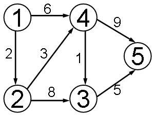
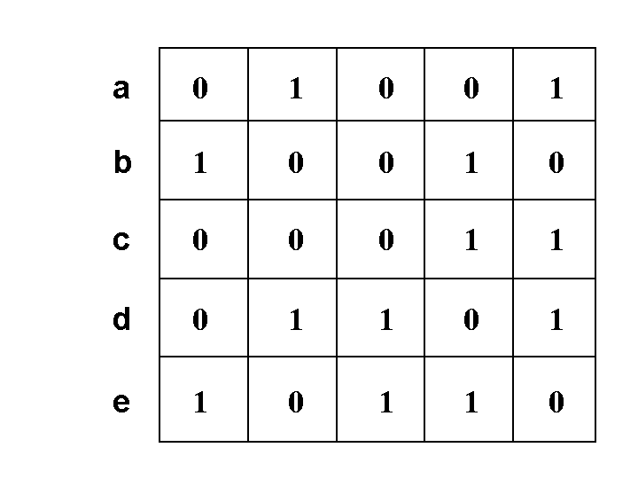
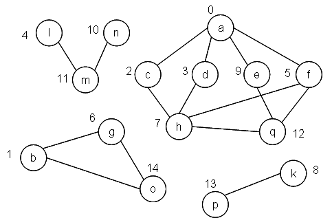

# 2009～2010 学年第二学期《数据结构与算法》期末考试试卷 A 卷（样例）参考答案

* **课程名称**：《数据结构与算法》期末考试卷（A卷）
* **适用年级**：计算机学院 2006 级（2009—2010 学年第二学期）
* **考试时间**：2010 年 6 月 11 日 9:55 ~ 11:30
* **考试形式**：“A4 一纸开卷”（允许携带一张 A4 纸的复习提纲）

| 题号 | 一 | 二 | 三 | 四 | 五 | 总分 |
| :---: | :---: | :---: | :---: | :---: | :---: | :---: |
| **分数** | | | | | | |

> **请注意**：不要将试卷拆开！卷面不整洁最多可以扣 3 分。

## 一、填空题（本大题共 5 小题，每题 2 分）

（不写解答过程，将答案直接填写在试题的空上）

**1. 按数据元素之间的逻辑关系来划分，数据结构的逻辑结构可分为四种基本类型，分别是：______、______、______ 和 ______。**

> **【参考答案】**
> 集合（或集合结构）、线性结构、树形结构、图形结构（或网状结构）

**2. 已知两个递增有序的单链表（长度分别为 $m$ 和 $n$），如果将其归并成一个按元素递减有序的单链表，则可能达到的最好时间复杂度为 ______。**

> **【参考答案】**
> $O(m+n)$
>
> **【解析】** 利用原链表结点空间，采用头插法（逆序插入）依次比较并归并两个递增单链表，只需遍历两个链表各一次，时间复杂度为 $O(m+n)$。

**3. 深度为 $h$ 的完全二叉树至少应该包含的结点个数为 ______。**

> **【参考答案】**
> $2^{h-1}$
>
> **【解析】** 深度为 $h$ 的完全二叉树前 $h-1$ 层为满二叉树（共 $2^{h-1}-1$ 个结点），第 $h$ 层至少有 $1$ 个结点，故至少包含 $2^{h-1}$ 个结点。

**4. 一个有 $n$ 个顶点且含环路的无向连通图，所包含的边数至少应为 ______。**

> **【参考答案】**
> $n$
>
> **【解析】** $n$ 个顶点的无向连通图至少需要 $n-1$ 条边（生成树，无环），若含环路则至少再增加 $1$ 条边，因此至少有 $n$ 条边。

**5. 在最好和最坏情况下，算法的时间复杂度均为 $O(n \log n)$ 且稳定的排序方法是 ______。**

> **【参考答案】**
> 归并排序（或 2-路归并排序）

## 二、单项选择题（本大题共 5 小题，每题 2 分）

**1. 在抽象数据类型的定义中所包含的三个要素是（ C ）。**

* A. 数据元素、数据类型和基本操作
* B. 逻辑结构、物理结构和基本操作
* C. 数据对象、数据关系和基本操作
* D. 数据对象、数据关系和存储结构

> **【参考答案】** C

**2. 为一元的稀疏代数多项式推荐的存储表示应为（ B ）。**

* A. 广义表
* B. 带头结点的单向链表
* C. 带头结点的双向链表
* D. 顺序表

> **【参考答案】** B

**3. 如果已知一棵树的先根遍历序列为 `ABCDEF`，后根遍历序列为 `CEDFBA`，则对这棵树进行按层遍历所得到的遍历序列应该是（ D ）。**

* A. `A B C D E F`
* B. `A B C E F D`
* C. `A B F C D E`
* D. `A B C D F E`

> **【参考答案】** D
>
> **【解析】** 由先根序列 `ABCDEF` 和后根序列 `CEDFBA` 可知：根结点为 `A`，且 `A` 只有一个孩子 `B`；在以 `B` 为根的子树中，先根序列为 `CDEF`、后根序列为 `CEDF`，可知 `B` 有三个孩子依次为 `C`、`D`、`F`，且 `E` 是 `D` 的孩子。因此各层结点依次为：第 1 层 `A`，第 2 层 `B`，第 3 层 `C D F`，第 4 层 `E`，按层遍历序列为 `A B C D F E`。

**4. 对于下图所示的带权有向图，从顶点 1 到顶点 5 的最短路径为（ D ）。**

<div align="center">
  
  <p><em>图1：第 4 题带权有向图</em></p>
</div>

* A. `1, 4, 5`
* B. `1, 2, 3, 5`
* C. `1, 4, 3, 5`
* D. `1, 2, 4, 3, 5`

> **【参考答案】** D
>
> **【解析】** 各路径长度比较：
> - 路径 `1 -> 4 -> 5` 长度为 $6 + 9 = 15$；
> - 路径 `1 -> 2 -> 3 -> 5` 长度为 $2 + 8 + 5 = 15$；
> - 路径 `1 -> 4 -> 3 -> 5` 长度为 $6 + 1 + 5 = 12$；
> - 路径 `1 -> 2 -> 4 -> 3 -> 5` 长度为 $2 + 3 + 1 + 5 = 11$（最短）。

**5. 要想让平均查找长度达到最小，当由关键字集合 $\{05, 11, 21, 25, 37, 40, 41, 62, 84\}$ 构建二叉排序树时，第一个插入的关键字应为（ B ）。**

* A. `05`
* B. `37`
* C. `41`
* D. `62`

> **【参考答案】** B
>
> **【解析】** 要使二叉排序树的平均查找长度最小，应使其形态尽量接近平衡二叉树（与折半查找判定树一致），故根结点（第一个插入的关键字）应取有序序列的中位数 `37`。

## 三、解答题（本大题共 5 小题，每题 9 分）

### 1. 广义表的存储表示、深度与长度

已知广义表的类型定义为：

```c
typedef enum { ATOM, LIST } ElemTag;
// ATOM == 0：原子，LIST == 1：子表
typedef struct GLNode {
    ElemTag tag;
    union {
        char atom;
        struct { struct GLNode *hp, *tp; } ptr;
        // ptr 是表结点的指针域，ptr.hp 和 ptr.tp 分别指向表头和表尾
    };
} *GList;
```

请画出广义表 `(d, (a, (d, c, b)), a, ((d), b))` 的存储表示，并指出其深度和长度。

> **【参考答案】**
> - **广义表的长度**：$4$（最外层包含 4 个元素：`d`、`(a, (d, c, b))`、`a`、`((d), b)`）。
> - **广义表的深度**：$3$（括号的最大嵌套层数为 3 层）。
> - **头尾链表存储结构示意图**：
>
> ```mermaid
> flowchart TD
>     L1["[1 | hp | tp] (第1个元素)"] --> A_d1["[0 | d]"]
>     L1 --> L2["[1 | hp | tp] (第2个元素)"]
>     L2 --> L3["[1 | hp | tp] (第3个元素)"]
>     L3 --> A_a2["[0 | a]"]
>     L3 --> L4["[1 | hp | ^] (第4个元素)"]
>
>     L2 --> S1_1["[1 | hp | tp]"]
>     S1_1 --> A_a1["[0 | a]"]
>     S1_1 --> S1_2["[1 | hp | ^]"]
>     S1_2 --> S2_1["[1 | hp | tp]"]
>     S2_1 --> A_d2["[0 | d]"]
>     S2_1 --> S2_2["[1 | hp | tp]"]
>     S2_2 --> A_c["[0 | c]"]
>     S2_2 --> S2_3["[1 | hp | ^]"]
>     S2_3 --> A_b1["[0 | b]"]
>
>     L4 --> S3_1["[1 | hp | tp]"]
>     S3_1 --> S4_1["[1 | hp | ^]"]
>     S4_1 --> A_d3["[0 | d]"]
>     S3_1 --> S3_2["[1 | hp | ^]"]
>     S3_2 --> A_b2["[0 | b]"]
> ```

### 2. 赫夫曼树与赫夫曼译码

根据某字母集 $\{s, t, a, e, d\}$ 中每个字母在电文中出现的频度，得出的赫夫曼编码如下：

- `s`: `101`
- `t`: `00`
- `a`: `01`
- `e`: `11`
- `d`: `100`

1. 请画出对应的赫夫曼树；
2. 假设接收到的电文为 `110100100010001`，请依据赫夫曼编码给出译电文。

> **【参考答案】**
> 1. **对应的赫夫曼树**（约定左分支编码为 `0`，右分支编码为 `1`）：
>
> ```mermaid
> flowchart TD
>     R(("根")) -- "0" --> N0((" "))
>     R -- "1" --> N1((" "))
>     N0 -- "0" --> T["t (00)"]
>     N0 -- "1" --> A["a (01)"]
>     N1 -- "0" --> N10((" "))
>     N1 -- "1" --> E["e (11)"]
>     N10 -- "0" --> D["d (100)"]
>     N10 -- "1" --> S["s (101)"]
> ```
>
> 2. **电文译码**：
>    将电文 `110100100010001` 按前缀码切分为：`11` / `01` / `00` / `100` / `01` / `00` / `01`，对应的译电文为 **`eatdata`**。

### 3. 无向图的邻接矩阵与遍历

已知一个无向图的顶点集为 $\{a, b, c, d, e\}$，其邻接矩阵如下图所示：

<div align="center">
  
  <p><em>图2：第 3 题无向图邻接矩阵</em></p>
</div>

1. 画出该无向图的逻辑结构图；
2. 根据此邻接矩阵，从顶点 $b$ 出发分别进行深度优先搜索遍历和广度优先搜索遍历，写出相应遍历的顶点序列。

> **【参考答案】**
> 1. **无向图的逻辑结构**：
>    图中包含 6 条无向边：$(a, b)$、$(a, e)$、$(b, d)$、$(c, d)$、$(c, e)$、$(d, e)$。
>
> ```mermaid
> flowchart LR
>     a(("a")) --- b(("b"))
>     a --- e(("e"))
>     b --- d(("d"))
>     d --- c(("c"))
>     d --- e
>     c --- e
> ```
>
> 2. **遍历顶点序列**（按邻接矩阵行/列序号 $a, b, c, d, e$ 的先后次序访问邻接点）：
>    - **深度优先搜索遍历（DFS）序列**：$b, a, e, c, d$
>    - **广度优先搜索遍历（BFS）序列**：$b, a, d, e, c$

### 4. 哈希表构造与查找分析

假设哈希表 `H[0..17]` 所使用的哈希函数为 $H(\text{key}) = \text{key} \bmod 17$，并以线性探测再散列法解决冲突。要求：

1. 为关键字序列 $(13, 21, 32, 18, 31, 30, 46, 47, 41, 63, 59)$ 构造哈希表；
2. 计算查找成功时的平均查找长度 $\text{ASL}$；
3. 列出查找某关键字 `64` 时，依次比较过的关键字。

| 下标 | 0 | 1 | 2 | 3 | 4 | 5 | 6 | 7 | 8 | 9 | 10 | 11 | 12 | 13 | 14 | 15 | 16 | 17 |
| :---: | :---: | :---: | :---: | :---: | :---: | :---: | :---: | :---: | :---: | :---: | :---: | :---: | :---: | :---: | :---: | :---: | :---: | :---: |
| **H[0..17]** | | | | | | | | | | | | | | | | | | |

> **【参考答案】**
> 1. **构造完成的哈希表 `H[0..17]`** 如下（含各关键字的探测次数）：
>
> | 下标 | 0 | 1 | 2 | 3 | 4 | 5 | 6 | 7 | 8 | 9 | 10 | 11 | 12 | 13 | 14 | 15 | 16 | 17 |
> | :---: | :---: | :---: | :---: | :---: | :---: | :---: | :---: | :---: | :---: | :---: | :---: | :---: | :---: | :---: | :---: | :---: | :---: | :---: |
> | **关键字** | 63 | 18 | | | 21 | | | 41 | 59 | | | | 46 | 13 | 31 | 32 | 30 | 47 |
> | **探测次数** | 7 | 1 | | | 1 | | | 1 | 1 | | | | 1 | 1 | 1 | 1 | 4 | 5 |
>
> 2. **查找成功时的平均查找长度 $\text{ASL}$**：
>
> $$
> \text{ASL}_{\text{成功}} = \frac{1 + 1 + 1 + 1 + 1 + 4 + 1 + 5 + 1 + 7 + 1}{11} = \frac{24}{11} \approx 2.18
> $$
>
> 3. **查找关键字 `64` 的比较序列**：
>    计算 $H(64) = 64 \bmod 17 = 13$，从下标 `13` 开始依次向右（循环至下标 `0`）探测直至遇到空单元 `H[2]`，依次比较过的关键字为：
>    `13, 31, 32, 30, 47, 63, 18`

### 5. 快速排序划分过程

对于给定的关键字序列 $(483, 67, 41, 888, 150, 877, 255, 633, 442)$，请按快速排序算法，写出在排序过程中前 3 次调用 `Partition(L, low, high)` 后关键字的排列情况。

* **初始状态**：`483, 67, 41, 888, 150, 877, 255, 633, 442`
* **第 1 次调用后**：__________________________________________________
* **第 2 次调用后**：__________________________________________________
* **第 3 次调用后**：__________________________________________________

> **【参考答案】**
> - **第 1 次调用后**（对区间 `[1..9]` 以 `483` 为枢轴划分）：
>   `442, 67, 41, 255, 150, 483, 877, 633, 888`
> - **第 2 次调用后**（递归对左子区间 `[1..5]` 以 `442` 为枢轴划分）：
>   `150, 67, 41, 255, 442, 483, 877, 633, 888`
> - **第 3 次调用后**（继续递归对左子区间 `[1..4]` 以 `150` 为枢轴划分）：
>   `41, 67, 150, 255, 442, 483, 877, 633, 888`
>   *（注：若按层对第 1 次划分后的右子区间 `[7..9]` 调用 `Partition(L, 7, 9)`，则结果为 `150, 67, 41, 255, 442, 483, 633, 877, 888`。）*

## 四、算法阅读题（15 分）

根据下图，阅读算法 `programXP`，并回答两个问题。

<div align="center">
  
  <p><em>图3：第四大题无向图结构</em></p>
</div>

```c
void DFS(Graph G, int v, int mark) {
    visited[v] = mark;   visitFunc(v);
    for(w=FirstAdjVex(G, v); w != 0; w=NextAdjVex(G,v,w))
        if ( !visited[w] )  DFS(G, w, mark);
} // DFS

void programXP(Graph G, int &visited[ ]) {
    for (v=0; v<G.vexnum; ++v)
        visited[v] = 0; // 访问标志数组初始化
    s=0;
    for (v=0; v<G.vexnum; ++v)
        if ( !visited[v] ) {
            s++;
            DFS(G, v, s);
        }
}
```

1. 写出运行 `programXP()` 算法后 `visited[]` 的最终结果：

| 下标 | 0 | 1 | 2 | 3 | 4 | 5 | 6 | 7 | 8 | 9 | 10 | 11 | 12 | 13 | 14 |
| :---: | :---: | :---: | :---: | :---: | :---: | :---: | :---: | :---: | :---: | :---: | :---: | :---: | :---: | :---: | :---: |
| **visited** | | | | | | | | | | | | | | | |

2. 简述这个算法的功能。

> **【参考答案】**
> 1. **`visited[]` 数组的最终结果**：
>
> | 下标 | 0 | 1 | 2 | 3 | 4 | 5 | 6 | 7 | 8 | 9 | 10 | 11 | 12 | 13 | 14 |
> | :---: | :---: | :---: | :---: | :---: | :---: | :---: | :---: | :---: | :---: | :---: | :---: | :---: | :---: | :---: | :---: |
> | **visited** | 1 | 2 | 1 | 1 | 3 | 1 | 2 | 1 | 4 | 1 | 3 | 3 | 1 | 4 | 2 |
>
>    - **第 1 个连通分量（标记为 `1`）**：包含顶点 `0(a), 2(c), 3(d), 5(f), 7(h), 9(e), 12(q)`；
>    - **第 2 个连通分量（标记为 `2`）**：包含顶点 `1(b), 6(g), 14(o)`；
>    - **第 3 个连通分量（标记为 `3`）**：包含顶点 `4(l), 10(n), 11(m)`；
>    - **第 4 个连通分量（标记为 `4`）**：包含顶点 `8(k), 13(p)`。
> 2. **算法功能**：
>    利用深度优先搜索（DFS）遍历无向图 $G$，统计图 $G$ 中连通分量的个数 $s$，并将第 $s$ 个连通分量中所有顶点的 `visited` 数组元素值标记为对应的连通分量序号 $s$（即对不同连通分量的顶点进行划分与编号）。

## 五、算法设计（本大题共 2 小题，第 1 题 15 分，第 2 题 5 分）

（算法设计题的答案请简述算法思想，语句加注释）

### 1. 判断二叉排序树是否为平衡二叉树

设计一个递归算法，判断一个给定的二叉排序树是否是平衡二叉树（注：平衡二叉树中任意结点的左右子树深度之差的绝对值均不大于 $1$）。

算法的函数原型为 `int isAVL(BSTree T, int &high)`，其中 `T` 是指向二叉树根的指针，`high` 是这棵二叉树的树深。若该二叉排序树是平衡的，则返回 `1`；否则返回 `0`。

二叉排序树的类型定义如下：

```c
typedef struct BiTNode { // 二叉排序树的结点结构
    ElemType data;       // 数据域
    struct BiTNode *lchild, *rchild; // 左、右孩子的指针域
} BiTNode, *BSTree;
```

> **【参考答案】**
> - **算法思想**：采用后序遍历的递归思想。
>     - 若当前树 `T` 为空树，则高度 `high = 0`，返回 `1`（空树是平衡二叉树）。
>     - 递归判断左子树是否为平衡二叉树，并求得左子树高度 `lh`；若左子树不平衡，直接返回 `0`。
>     - 递归判断右子树是否为平衡二叉树，并求得右子树高度 `rh`；若右子树不平衡，直接返回 `0`。
>     - 计算当前树的高度 `high = (lh > rh ? lh : rh) + 1`，并检查左右子树高度之差的绝对值是否不超过 $1$：若 $\vert \text{lh} - \text{rh} \vert \le 1$ 则返回 `1`，否则返回 `0`。
> - **C 语言实现代码**：
>
> ```c
> int isAVL(BSTree T, int &high) {
>     int lh = 0, rh = 0;
>     if (T == NULL) {
>         high = 0;               // 空树深度为 0，且是平衡的
>         return 1;
>     }
>     if (!isAVL(T->lchild, lh))  // 递归判断左子树是否平衡，并获取左子树深度 lh
>         return 0;
>     if (!isAVL(T->rchild, rh))  // 递归判断右子树是否平衡，并获取右子树深度 rh
>         return 0;
>     high = (lh > rh ? lh : rh) + 1; // 当前二叉树的高度为左右子树最大高度加 1
>     if (lh - rh >= -1 && lh - rh <= 1)
>         return 1;               // 左右子树高度差绝对值不大于 1，平衡
>     else
>         return 0;               // 不平衡
> }
> ```

### 2. 部分排序问题算法设计

设计一个“部分排序”问题的算法，即在不进行整体排序的情况下，从长度为 $n$ 的无序序列中，仅挑选 $m$（$m \ll n$）个值最大的元素，形成一个子序列，并按递减顺序排列好，要求算法的时间复杂度控制在 $O(m \log n)$，空间复杂度控制在 $O(1)$。

实际的问题背景出现在“推荐免试研究生”的名单选择等应用需求中。例如，无需进行整体排序，从 300 多人的毕业班中求得加权总分排名最高的 20 名学生，并从高到低排序输出。

> **【参考答案】**
> - **算法思想**：采用**堆排序（大根堆）**的思想。
>     - **原地建初堆**：将长度为 $n$ 的无序序列 `R[1..n]` 原地调整为一个大根堆（从第 $\lfloor n/2 \rfloor$ 个元素开始自底向上调用筛选函数 `HeapAdjust`），建堆时间复杂度为 $O(n)$。
>     - **筛选前 $m$ 个最大元素**：仅需执行 $m$ 趟堆顶元素的输出与调整操作。在第 $i$ 趟（$1 \le i \le m$）中，堆顶元素 `R[1]` 即为当前剩余元素中的最大值，将其输出（或与堆尾元素 `R[n - i + 1]` 交换），然后对剩余 `R[1..n - i]` 重新调整为大根堆，每次调整耗时 $O(\log n)$。
>     - **复杂度分析**：执行 $m$ 趟调整的时间复杂度为 $O(m \log n)$，仅使用常数个辅助变量，空间复杂度为 $O(1)$。
> - **C 语言实现代码**：
>
> ```c
> // 筛选调整函数：已知 R[s..t] 中除 R[s] 外均满足大根堆定义，调整 R[s] 使 R[s..t] 成为大根堆
> void HeapAdjust(ElemType R[], int s, int t) {
>     ElemType rc = R[s];
>     for (int j = 2 * s; j <= t; j *= 2) {
>         if (j < t && R[j] < R[j + 1])
>             j++;                // j 指向值较大的孩子结点
>         if (rc >= R[j])
>             break;              // rc 已大于等于最大孩子，无需继续下移
>         R[s] = R[j];
>         s = j;
>     }
>     R[s] = rc;
> }
>
> // 部分堆排序：从 R[1..n] 中挑出最大的 m 个元素并按递减顺序输出
> void PartialHeapSort(ElemType R[], int n, int m) {
>     int i;
>     ElemType temp;
>     // 1. 将初始无序序列 R[1..n] 建成大根堆
>     for (i = n / 2; i >= 1; i--) {
>         HeapAdjust(R, i, n);
>     }
>     // 2. 仅进行 m 趟堆顶提取与筛选调整
>     for (i = n; i > n - m && i >= 1; i--) {
>         printf("%d ", R[1]);    // 按递减顺序输出当前最大值 R[1]
>         temp = R[1];            // 将堆顶元素与当前堆底元素交换
>         R[1] = R[i];
>         R[i] = temp;
>         HeapAdjust(R, 1, i - 1); // 将剩余元素 R[1..i-1] 重新调整为大根堆
>     }
> }
> ```
