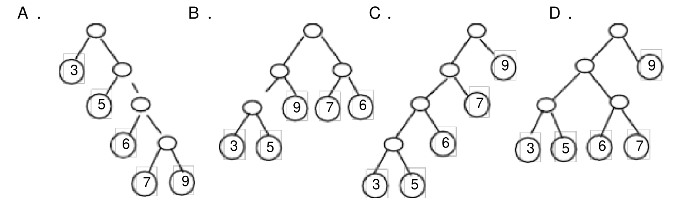
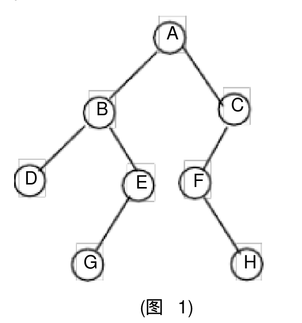
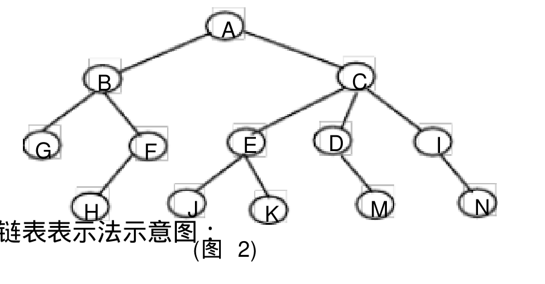
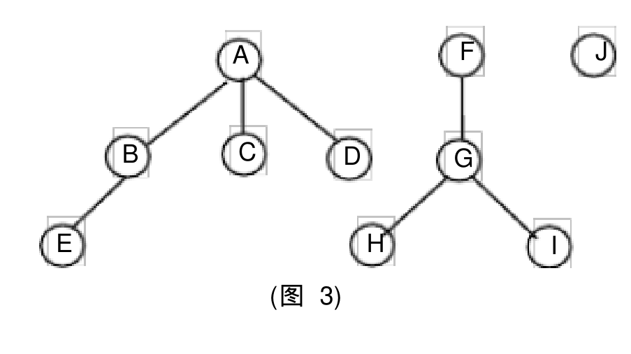
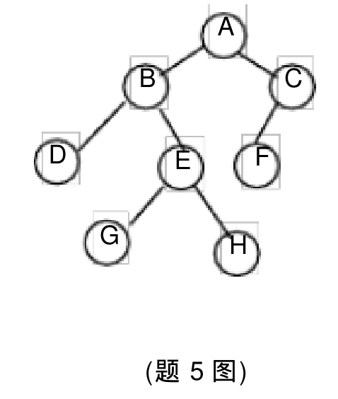

# 《数据结构与算法》课后习题（第 2 至 5 章）

## 2.3 第 2 章（线性表）课后习题

### 2.3.2 判断题

1. 线性表的逻辑顺序与存储顺序总是一致的。 `(   )`
2. 顺序存储的线性表可以按序号随机存取。 `(   )`
3. 顺序表的插入和删除操作不需要付出很大的代价，因为平均每次操作只有近一半的元素需要移动。 `(   )`
4. 线性表中的元素可以是各种各样的，但同一线性表中的数据元素具有相同的特性，因此是属于同一数据对象。 `(   )`
5. 在线性表的顺序存储结构中，逻辑上相邻的两个元素在物理位置上并不一定紧邻。 `(   )`
6. 在线性表的链式存储结构中，逻辑上相邻的元素在物理位置上不一定相邻。 `(   )`
7. 线性表的链式存储结构优于顺序存储结构。 `(   )`
8. 在线性表的顺序存储结构中，插入和删除时，移动元素的个数与该元素的位置有关。 `(   )`
9. 线性表的链式存储结构是用一组任意的存储单元来存储线性表中数据元素的。 `(   )`
10. 在单链表中，要取得某个元素，只要知道该元素的指针即可，因此，单链表是随机存取的存储结构。 `(   )`
11. 静态链表既有顺序存储的优点，又有动态链表的优点。所以，它存取表中第 $i$ 个元素的时间与 $i$ 无关。 `(   )`
12. 线性表的特点是每个元素都有一个前驱和一个后继。 `(   )`

### 2.3.3 算法设计题

**1. 设有一组初始记录关键字序列 $(K_1, K_2, \dots, K_n)$，要求设计一个算法能够在 $O(n)$ 的时间复杂度内将线性表划分成两部分，其中左半部分的每个关键字均小于 $K_1$，右半部分的每个关键字均大于等于 $K_1$。（注：原书对应题为：已知有实现顺序表的向量 `A[arrsize]`，其中的前 `elenum`（`elenum < arrsize`）个分量已按递增次序排好。试编写一算法，将给定的 `x` 插入到向量中的适当位置，以保持向量的有序性，并且分析算法的时间复杂度。）**

**2. 已知线性表中的元素以值递增有序排列，并以顺序表作存储结构。试写一高效的算法，删除表中所有值相同的多余元素（使得操作后的线性表中所有元素的值均不相同）。**

**3. 试编写一个高效的算法，将顺序表 `A` 中所有值在 $x \sim y$（$x \le y$）之间的所有元素删除之，要求空间复杂度为 $O(1)$，时间复杂度为 $O(n)$。**

**4. 已知向量 `R[n]` 中的元素都是字符，试编写一算法，使 `R[n]` 中的元素按字母字符、数字字符和其它字符的顺序排列。要求利用原来的存储空间，元素移动次数最小。**

**5. 设有一顺序表 $L = (a_1, a_2, \dots, a_m, b_1, b_2, \dots, b_n)$，试写一算法，将顺序表前 $m$ 个元素和后 $n$ 个元素整体互换，即将顺序表改变为 $(b_1, b_2, \dots, b_n, a_1, a_2, \dots, a_m)$。要求空间复杂度为 $O(1)$。**

**6. 已知带头结点的单链表 `L` 中的结点是按整数值递增排列的，试写一算法，将值为 `x` 的结点插入到表 `L` 中，使得 `L` 仍然递增有序，并且分析算法的时间复杂度。**

**7. 假设有两个按元素值递增次序排列的线性表，均以单链表形式存储。请编写算法将这两个单链表归并为一个按元素值递增次序排列的单链表，要求利用原来两个单链表的结点存放归并后的单链表。**

**8. 假设有一个长度大于 1 的循环单链表，其中既无头结点也无头指针。已知 `s` 为指向链表中某个结点的指针，试编写一个算法删除该结点的前驱结点。**

**9. 已知两个链表 `A` 和 `B` 分别表示两个集合，其元素递增排列。请设计算法求出 `A` 与 `B` 的交集 `C`，要求 `C` 另辟空间，且同样以元素递增的单链表形式存储。**

**10. 设有一双向链表，每个结点中除有 `prior`、`data` 和 `next` 三个域外，还有一个访问频度域 `freq`，在链表被启用前，其值均初始化为零。每当在链表上进行一次 `Locate(L, x)` 运算时，令元素值为 `x` 的结点中 `freq` 域的值增 1，并使此链表中结点保持按访问频度非递增（递减）的顺序排列，以便使频繁访问的结点总是靠近表头。试编写符合上述要求的 `Locate` 算法。**

---

## 3.3 第 3 章（栈和队列）课后习题

### 3.3.1 选择题

**1. 设有一链栈，栈顶指针为 `Top`，现有一个由指针 `p` 指向的结点要入栈，则可执行操作（   ）。**

* A. `Top->next=p; p=Top;`
* B. `p->next=Top->next; Top->next=p;`
* C. `p->next=Top; Top=p;`
* D. `p->next=Top; Top=Top->next;`

**2. 栈结构通常采用的两种存储结构是线性存储结构和链表存储结构，栈的本质特性是（   ）。**

* A. 先进先出
* B. 后进先出
* C. 进出无序
* D. 只进不出

**3. 设栈 $S$ 和队列 $Q$ 的初始状态为空，元素按 $1, 2, 3, \dots, n$ 的顺序入栈，每个元素出栈后立即进入队列 $Q$。若 $n$ 个元素出队的顺序是 $p_1, p_2, p_3, \dots, p_n$，且 $p_n = n$，则 $p_i$ 是（   ）。**

* A. $i$
* B. $n - i$
* C. $n - i + 1$
* D. 不确定

**4. 表达式 `a*(b-c)+d` 的后缀表达式是（   ）。**

* A. `abcd*-+`
* B. `abc-*d+`
* C. `abc-d*+`
* D. `ab-cd*+`

**5. 设有两个栈 $S_1, S_2$ 都采用顺序栈方式，并且共享一个存储区 $[0 \dots \text{maxsize}-1]$，为了尽量利用空间，减少溢出的可能，可采用栈顶相向、迎面增长的存储方式。设 $S_1, S_2$ 的栈顶指针分别为 `top[1]`、`top[2]`，则当 $S_1, S_2$ 合并空间栈满的条件是（   ）。**

* A. `top[1] == top[2]`
* B. `top[1] + 1 == top[2]`
* C. `top[1] + top[2] == maxsize`
* D. `top[1] - 1 == top[2]`

**6. 设栈 $S$ 的初始状态为空，现有 5 个元素组成的序列 `{a, b, c, d, e}`，对该序列在 $S$ 上依次进行操作：`push, push, pop, push, push, pop, push, pop, pop, pop`，则出栈的元素序列是（   ）。**

* A. `abcde`
* B. `decba`
* C. `dceab`
* D. `bdcea`

**7. 用单链表表示的链式队列的队头在链表的（   ）位置；若用带头结点的单链表表示队列，队头指针为 `f`，队尾指针为 `r`，将 `s` 指的结点入队的操作是（   ）。**

* A. 链头；`s->next=f; f=s;`
* B. 链头；`r->next=s; r=s;`
* C. 链尾；`r->next=s; r=s;`
* D. 链尾；`s->next=r; r=s;`

**8. 在具有头结点的链式队列中，若只有一个数据元素结点，则出队操作后，（   ）。**

* A. 头指针需要修改
* B. 尾指针需要修改
* C. 头、尾指针都不需修改
* D. 头、尾指针可能都要修改

**9. 递归过程或函数调用时，处理参数及返回地址，要用一种称为（   ）的数据结构。**

* A. 队列
* B. 多维数组
* C. 栈
* D. 线性表

**10. 栈和队列的共同点是（   ）。**

* A. 都是先进后出
* B. 都是先进先出
* C. 都是限制存取点的线性结构
* D. 没有共同点

### 3.3.2 判断题

1. 栈和队列都是操作受限的线性表。 `(   )`
2. 队列是限制在两端进行操作的线性表。 `(   )`
3. 消除递归不一定需要使用栈。 `(   )`
4. 顺序栈因为是顺序存储，所以可以随机存取栈中任意元素。 `(   )`
5. 在对不带头结点的链队列作出队操作时，不会改变头指针的值。 `(   )`

### 3.3.3 简答题

**1. 简述循环队列有什么优点？如何判别它的空和满？**

**2. 栈和队列各有什么特点？什么情况下需要用到栈，什么情况下需要用到队列？**

**3. 什么是递归？递归有什么优缺点？**

**4. 铁路进行列车调度时，常把站台设计成栈式结构的站台。试问：设有编号为 $1, 2, 3, 4$ 的四辆列车，顺序开进站台，则可能的出站序列有多少种？请分别列举出来。**

---

## 4.3 第 4 章（串、数组和广义表）课后习题

### 4.3.1 选择题

**1. 关于串的叙述中，不正确的是（   ）。**

* A. 串是字符的有限序列
* B. 空串是由零个字符构成的串
* C. 空串是由空格构成的串
* D. 模式匹配是串的一种重要运算

**2. 串的长度是指（   ）。**

* A. 串中所含不同字母的个数
* B. 串中所含字符的个数
* C. 串中所含不同字符的个数
* D. 串中所含非空格字符的个数

**3. 已知串 `S = 'aaab'`，其 `Next` 数组值为（   ）。**

* A. `0123`
* B. `1123`
* C. `1231`
* D. `1211`

**4. 二维数组 `M` 的成员是 6 个字符（每个字符占一个存储单元）组成的串，行下标 $i$ 的范围从 $0$ 到 $8$，列下标 $j$ 的范围从 $1$ 到 $10$，则：**
- **(1) 存放 `M` 至少需要（   ）个字节：**
    - A. `90` / B. `180` / C. `240` / D. `540`
- **(2) `M` 的第 8 列和第 5 行共占（   ）个字节：**
    - A. `108` / B. `114` / C. `54` / D. `60`
- **(3) 若 `M` 按行优先方式存储，元素 `M[8][5]` 的起始地址与当 `M` 按列优先方式存储时的（   ）元素的起始地址一致：**
    - A. `M[8][5]` / B. `M[3][10]` / C. `M[5][8]` / D. `M[0][9]`

**5. 数组 `A` 中，每个元素的存储占 3 个单元，行下标 $i$ 从 $1$ 到 $8$，列下标 $j$ 从 $1$ 到 $10$，从首地址 `SA` 开始连续存放在存储器内，则：**
- **(1) 存放该数组至少需要的单元个数是（   ）：**
    - A. `80` / B. `100` / C. `240` / D. `270`
- **(2) 若该数组按行存放，元素 `A[8][5]` 的起始地址是（   ）：**
    - A. `SA+141` / B. `SA+144` / C. `SA+222` / D. `SA+225`
- **(3) 若该数组按列存放，元素 `A[8][5]` 的起始地址是（   ）：**
    - A. `SA+141` / B. `SA+180` / C. `SA+117` / D. `SA+225`

**6. 稀疏矩阵采用压缩存储，一般有（   ）两种方法。**

* A. 二维数组和三维数组
* B. 三元组和散列
* C. 三元组表和十字链表
* D. 散列和十字链表

### 4.3.2 判断题

1. 串相等是指两个串的长度相等。 `(   )`
2. KMP 算法的特点是在模式匹配时指示主串的指针不会变小。 `(   )`
3. 稀疏矩阵压缩存储后，必会失去随机存取功能。 `(   )`
4. 数组是线性结构的一种推广，因此与线性表一样，可以对它进行插入、删除等操作。 `(   )`
5. 若采用三元组存储稀疏矩阵，把每个元素的行下标和列下标互换，就完成了对该矩阵的转置运算。 `(   )`
6. 若一个广义表的表头为空表，则此广义表亦为空表。 `(   )`
7. 所谓取广义表的表尾就是返回广义表中最后一个元素。 `(   )`

### 4.3.3 简答题

**1. KMP 算法较朴素的模式匹配算法有哪些改进？**

**2. 设字符串 `S = 'aabaabaabaac'`，`P = 'aabaac'`。**
- **(1) 给出 `S` 和 `P` 的 `next` 值和 `nextval` 值；**
- **(2) 若 `S` 作主串，`P` 作模式串，试给出利用 BF 算法和 KMP 算法的匹配过程。**

**3. 假设按行优先存储整数数组 `A[9][3][5][8]` 时，第一个元素的字节地址是 $100$，每个整数占 4 个字节。问下列元素的存储地址是什么？**
- **(1) $a_{0000}$**
- **(2) $a_{1111}$**
- **(3) $a_{3125}$**
- **(4) $a_{8247}$**

**4. 假设一个准对角矩阵：**

$$
A = \begin{pmatrix}
a_{11} & a_{12} & & & & \\
a_{21} & a_{22} & & & & \\
& & a_{33} & a_{34} & & \\
& & a_{43} & a_{44} & & \\
& & & & \ddots & \\
& & & & a_{2m-1, 2m-1} & a_{2m-1, 2m} \\
& & & & a_{2m, 2m-1} & a_{2m, 2m}
\end{pmatrix}
$$

**按以下方式存储于一维数组 `B[4m]` 中（$m$ 为一个整数）：**

| 下标 | 0 | 1 | 2 | 3 | 4 | 5 | 6 | $\dots$ | $k$ | $\dots$ | $4m-2$ | $4m-1$ |
| :--- | :---: | :---: | :---: | :---: | :---: | :---: | :---: | :---: | :---: | :---: | :---: | :---: |
| 元素 | $a_{11}$ | $a_{12}$ | $a_{21}$ | $a_{22}$ | $a_{33}$ | $a_{34}$ | $a_{43}$ | $\dots$ | $a_{ij}$ | $\dots$ | $a_{2m, 2m-1}$ | $a_{2m, 2m}$ |

**写出下标转换函数 $k = f(i, j)$。**

**5. 设有 $n \times n$ 的带宽为 3 的带状矩阵 $A$，将其 3 条对角线上的元素存于数组 `B[3][n]` 中，使得元素 `B[u][v]` $= a_{ij}$，试推导出从 $(i, j)$ 到 $(u, v)$ 的下标变换公式。**

**6. 现有如下的稀疏矩阵 $A$，要求画出以下各种表示方法：**
- **(1) 三元组表表示法；**
- **(2) 十字链表法。**

$$
A = \begin{pmatrix}
0 & 0 & 0 & 22 & 0 & -15 \\
0 & 13 & 3 & 0 & 0 & 0 \\
0 & 0 & 0 & -6 & 0 & 0 \\
0 & 0 & 0 & 0 & 0 & 0 \\
91 & 0 & 0 & 0 & 0 & 0 \\
0 & 0 & 28 & 0 & 0 & 0
\end{pmatrix}
$$

**7. 画出下列广义表的头尾表示存储结构示意图：**
- **(1) `A = ((a, b, c), d, (a, b, c))`**
- **(2) `B = (a, (b, (c, d), e), f)`**

---

## 5.3 第 5 章（树和二叉树）课后习题

### 5.3.1 选择题

**1. 下列说法正确的是（   ）。**

* A. 二叉树中任何一个结点的度都为 2
* B. 二叉树的度为 2
* C. 一棵二叉树的度可小于 2
* D. 任何一棵二叉树中至少有一个结点的度为 2

**2. 以二叉链表作为二叉树的存储结构，在具有 $n$ 个结点的二叉链表中（$n > 0$），空链域的个数为（   ）。**

* A. $2n - 1$
* B. $n - 1$
* C. $n + 1$
* D. $2n + 1$

**3. 线索化二叉树中，某结点 `*p` 没有孩子的充要条件是（   ）。**

* A. `p->lchild == NULL`
* B. `p->ltag == 1` 且 `p->rtag == 1`
* C. `p->ltag == 0`
* D. `p->lchild == NULL` 且 `p->ltag == 1`

**4. 如果结点 $A$ 有 3 个兄弟，而且 $B$ 是 $A$ 的双亲，则 $B$ 的度是（   ）。**

* A. 3
* B. 4
* C. 5
* D. 1

**5. 某二叉树 $T$ 有 $n$ 个结点，设按某种顺序对 $T$ 中的每个结点进行编号，编号值为 $1, 2, \dots, n$。且有如下性质：$T$ 中任意结点 $v$，其编号等于左子树上的最小编号减 1，而 $v$ 的右子树的结点中，其最小编号等于 $v$ 左子树上结点的最大编号加 1，这是按（   ）编号的。**

* A. 中序遍历序列
* B. 先序遍历序列
* C. 后序遍历序列
* D. 层次顺序

**6. 设 $F$ 是一个森林，$B$ 是由 $F$ 转换得到的二叉树，$F$ 中有 $n$ 个非终端结点，则 $B$ 中右指针域为空的结点有（   ）个。**

* A. $n - 1$
* B. $n$
* C. $n + 1$
* D. $n + 2$

**7. 一棵完全二叉树上有 $1001$ 个结点，其中叶子结点的个数是（   ）。**

* A. 500
* B. 501
* C. 490
* D. 495

**8. 设森林 $F$ 中有三棵树，第一、第二、第三棵树的结点个数分别为 $N_1, N_2$ 和 $N_3$。与森林 $F$ 对应的二叉树根结点的右子树上的结点个数是（   ）。**

* A. $N_1$
* B. $N_1 + N_2$
* C. $N_2$
* D. $N_2 + N_3$

**9. 任何一棵二叉树的叶结点在先序、中序、后序遍历序列中的相对次序（   ）。**

* A. 不发生改变
* B. 发生改变
* C. 不能确定
* D. 以上都不对

**10. 若一棵二叉树的后序遍历序列为 `dabec`，中序遍历序列为 `debac`，则先序遍历序列为（   ）。**

* A. `cbed`
* B. `decab`
* C. `deabc`
* D. `cedba`

**11. 若一棵二叉树的先序遍历序列为 `abdgcefh`，中序遍历的序列为 `dgbaechf`，则后序遍历的结果为（   ）。**

* A. `gcefha`
* B. `gdbecfha`
* C. `bdgaechf`
* D. `gdbehfca`

**12. 一棵非空二叉树的先序遍历序列与后序遍历序列正好相反，则该二叉树一定满足（   ）。**

* A. 所有的结点均无左孩子
* B. 所有的结点均无右孩子
* C. 只有一个叶子结点
* D. 是一棵满二叉树

**13. 引入线索二叉树的目的是（   ）。**

* A. 加快查找结点的前驱或后继的速度
* B. 为了能在二叉树中方便的进行插入与删除
* C. 为了能方便的找到双亲
* D. 使二叉树的遍历结果唯一

**14. 设高度为 $h$ 的二叉树上只有度为 0 和度为 2 的结点，则此类二叉树中所包含的结点数至少为（   ）。**

* A. $2h$
* B. $2h - 1$
* C. $2h + 1$
* D. $h + 1$

**15. 一个具有 567 个结点的二叉树的高 $h$ 为（   ）。**

* A. 9
* B. 10
* C. 9 至 566 之间
* D. 10 至 567 之间

**16. 给一个整数集合 $\{3, 5, 6, 7, 9\}$，与该整数集合对应的哈夫曼树是（   ）。**

  
  
<em>图1：第16题哈夫曼树选项示意图</em>

* A. 选项 A
* B. 选项 B
* C. 选项 C
* D. 选项 D

### 5.3.2 判断题

1. 二叉树是树的特殊形式。 `(   )`
2. 由树转换成二叉树，其根结点的右子树总是空的。 `(   )`
3. 先根遍历一棵树和先序遍历与该树对应的二叉树，其结果不同。 `(   )`
4. 先根遍历森林和先序遍历与该森林对应的二叉树，其结果不同。 `(   )`
5. 完全二叉树中，若一个结点没有左孩子，则它必是叶子。 `(   )`
6. 对于有 $N$ 个结点的二叉树，其高度为 $\lfloor \log_2 N \rfloor + 1$。 `(   )`
7. 若一个结点是某二叉树子树的中序遍历序列中的最后一个结点，则它必是该子树的先序遍历序列中的最后一个结点。 `(   )`
8. 若一个结点是某二叉树子树的中序遍历序列中的第一个结点，则它必是该子树的后序遍历序列中的第一个结点。 `(   )`
9. 不使用递归也可实现二叉树的先序、中序和后序遍历。 `(   )`
10. 先序遍历二叉树的序列中，任何结点的子树的所有结点不一定跟在该结点之后。 `(   )`
11. 先序和中序遍历用线索树方式存储的二叉树，不必使用栈。 `(   )`
12. 在后序线索二叉树中，在任何情况下都能够很方便地找到任意结点的后继。 `(   )`
13. 哈夫曼树是带权路径长度最短的树，路径上权值较大的结点离根较近。 `(   )`
14. 在哈夫曼编码中，出现频率相同的字符编码长度也一定相同。 `(   )`
15. 用一维数组存放二叉树时，总是以先序遍历存储结点。 `(   )`
16. 由先序序列和后序序列能唯一确定一棵二叉树。 `(   )`
17. 由先序序列和中序序列能唯一确定一棵二叉树。 `(   )`
18. 对一棵二叉树进行层次遍历时，应借助于一个栈。 `(   )`
19. 完全二叉树可采用顺序存储结构实现存储，非完全二叉树则不能。 `(   )`
20. 满二叉树一定是完全二叉树，反之未必。 `(   )`

### 5.3.3 简答题

**1. 一棵度为 2 的树与一棵二叉树有何区别？树与二叉树之间有何区别？**

**2. 对于图 1 所示二叉树，试给出：**
- **(1) 它的顺序存储结构示意图；**
- **(2) 它的二叉链表存储结构示意图；**
- **(3) 它的三叉链表存储结构示意图。**

  
  
<em>图2：简答题第2题（图1）所示的二叉树</em>

**3. 对于图 2 所示的树，试给出：**
- **(1) 双亲数组表示法示意图；**
- **(2) 孩子链表表示法示意图；**
- **(3) 孩子兄弟链表表示法示意图。**

  
  
<em>图3：简答题第3题（图2）所示的树</em>

**4. 画出图 3 所示的森林经转换后所对应的二叉树，并指出森林中满足什么条件的结点在二叉树中是叶子。**

  
  
<em>图4：简答题第4题（图3）所示的森林</em>

**5. 将题 5 图所示的二叉树转换成相应的森林。**

  
  
<em>图5：简答题第5题（题5图）所示的二叉树</em>

**6. 证明：在结点数多于 1 的哈夫曼树中不存在度为 1 的结点。**

**7. 证明：若哈夫曼树中有 $n$ 个叶结点，则树中共有 $2n - 1$ 个结点。**

**8. 证明：由二叉树的前序序列和中序序列可以唯一地确定一棵二叉树。**

**9. 已知一棵度为 $m$ 的树中有 $n_1$ 个度为 1 的结点，$n_2$ 个度为 2 的结点，$\dots$，$n_m$ 个度为 $m$ 的结点，问该树中共有多少个叶子结点？有多少个非终端结点？**

**10. 在具有 $n$（$n > 1$）个结点的树中，深度最小的那棵树其深度是多少？它共有多少叶子和非叶子结点？深度最大的那棵树其深度是多少？它共有多少叶子和非叶子结点？**

**11. 设高度为 $h$ 的二叉树上只有度为 0 和度为 2 的结点，问该二叉树的结点数可能达到的最大值和最小值。**

**12. 求表达式 `a + b*(c - d) - e/f` 的波兰式（前缀式）和逆波兰式（后缀式）。**

**13. 画出和下列已知序列对应的树 $T$：**
- **树的先根次序访问序列为：`GFKDAIEBCHJ`；**
- **树的后根访问次序为：`DIAEKFCJHBG`。**

**14. 画出和下列已知序列对应的森林 $F$：**
- **森林的先根次序访问序列为：`ABCDEFGHIJKL`；**
- **森林的后根访问次序为：`CBEFDGAJIKLH`。**

**15. 画出和下列已知序列对应的二叉树 $T$：**
- **二叉树的层次访问序列为：`ABCDEFGHIJ`；**
- **二叉树的中序访问次序为：`DBGEHJACIF`。**

**16. 假设用于通信的电文由字符集 $\{a, b, c, d, e, f, g\}$ 中的字母构成。它们在电文中出现的频度分别为 $\{0.31, 0.16, 0.10, 0.08, 0.11, 0.20, 0.04\}$。**
- **(1) 为这 7 个字母设计哈夫曼编码。**
- **(2) 对这 7 个字母进行等长编码，至少需要几位二进制数？哈夫曼编码比等长编码使电文总长压缩多少？**

### 5.3.4 算法设计题

**1. 给定一棵用二叉链表表示的二叉树，其根指针为 `root`，试写出求二叉树结点的数目的算法。**

**2. 请设计一个算法，要求该算法把二叉树的叶结点按从左至右的顺序链成一个单链表。二叉树按 `lchild-rchild` 方式存储，链接时用叶结点的 `rchild` 域存放链指针。**

**3. 给定一棵用二叉链表表示的二叉树，其根指针为 `root`，试写出求二叉树的深度的算法。**

**4. 给定一棵用二叉链表表示的二叉树，其根指针为 `root`，试求二叉树各结点的层数。**

**5. 给定一棵用二叉链表表示的二叉树，其根指针为 `root`，试写出将二叉树中所有结点的左、右子树相互交换的算法。**

**6. 一棵具有 $n$ 个结点的完全二叉树采用顺序结构存储，试设计非递归算法对其进行先序遍历。**
