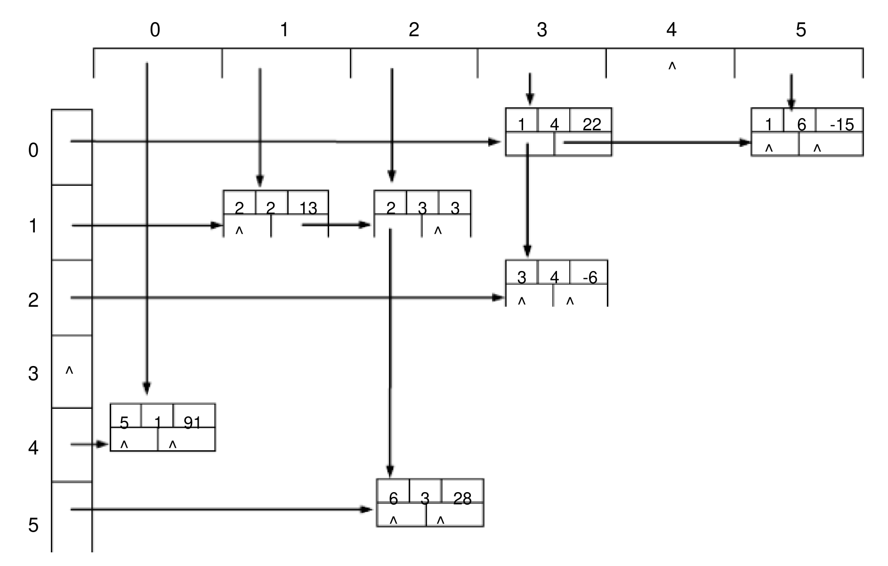
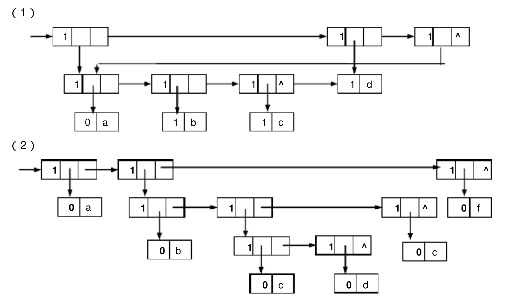
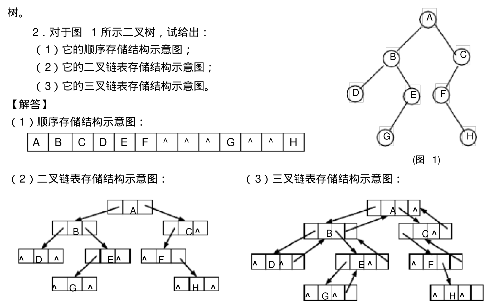
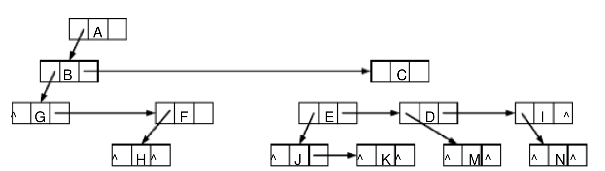
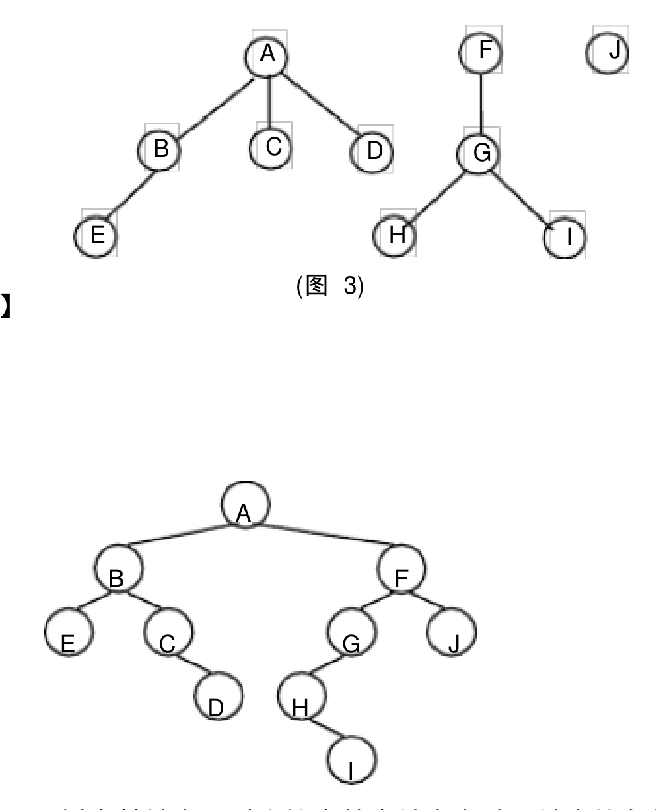
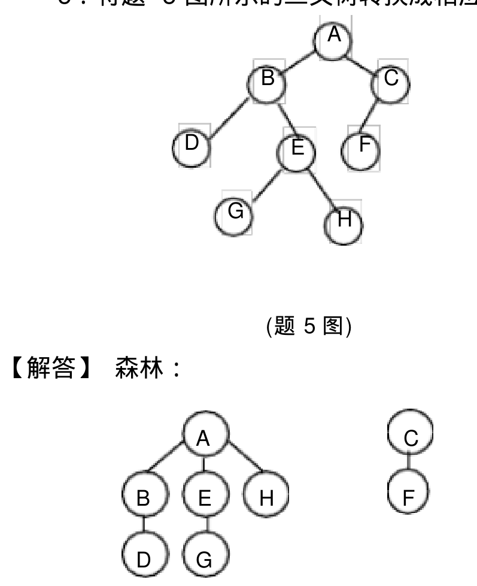
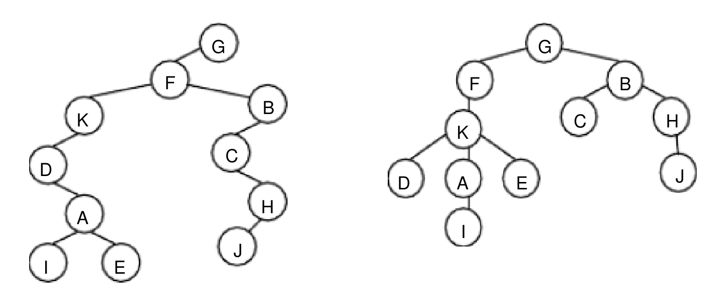
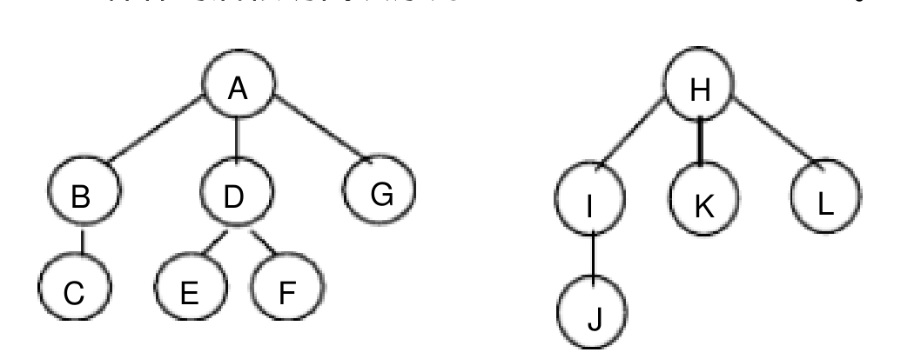
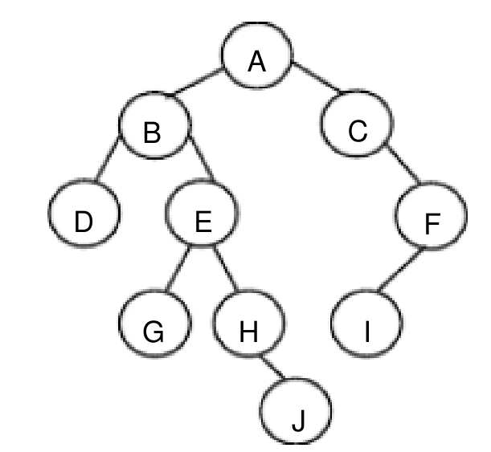

# 《数据结构与算法》课后习题（第 2 至 5 章）参考答案

## 2.3 第 2 章（线性表）课后习题解答

### 2.3.2 判断题

1. 线性表的逻辑顺序与存储顺序总是一致的。 `( × )`
2. 顺序存储的线性表可以按序号随机存取。 `( √ )`
3. 顺序表的插入和删除操作不需要付出很大的代价，因为平均每次操作只有近一半的元素需要移动。 `( × )`
4. 线性表中的元素可以是各种各样的，但同一线性表中的数据元素具有相同的特性，因此是属于同一数据对象。 `( √ )`
5. 在线性表的顺序存储结构中，逻辑上相邻的两个元素在物理位置上并不一定紧邻。 `( × )`
6. 在线性表的链式存储结构中，逻辑上相邻的元素在物理位置上不一定相邻。 `( √ )`
7. 线性表的链式存储结构优于顺序存储结构。 `( × )`
8. 在线性表的顺序存储结构中，插入和删除时，移动元素的个数与该元素的位置有关。 `( √ )`
9. 线性表的链式存储结构是用一组任意的存储单元来存储线性表中数据元素的。 `( √ )`
10. 在单链表中，要取得某个元素，只要知道该元素的指针即可，因此，单链表是随机存取的存储结构。 `( × )`
11. 静态链表既有顺序存储的优点，又有动态链表的优点。所以，它存取表中第 $i$ 个元素的时间与 $i$ 无关。 `( × )`
12. 线性表的特点是每个元素都有一个前驱和一个后继。 `( × )`

### 2.3.3 算法设计题

**1. 设有一组初始记录关键字序列 $(K_1, K_2, \dots, K_n)$，要求设计一个算法能够在 $O(n)$ 的时间复杂度内将线性表划分成两部分，其中左半部分的每个关键字均小于 $K_1$，右半部分的每个关键字均大于等于 $K_1$。（注：原书对应题为：已知有实现顺序表的向量 `A[arrsize]`，其中的前 `elenum`（`elenum < arrsize`）个分量已按递增次序排好。试编写一算法，将给定的 `x` 插入到向量中的适当位置，以保持向量的有序性，并且分析算法的时间复杂度。）**

> **【解答】**
>
> ```c
> int insert(int A[arrsize], int elenum, int x)
> {
>     int i, j;
>     if (elenum == arrsize - 1)
>         return 0;
>     else
>     {
>         i = elenum - 1;
>         while (i >= 0 && A[i] > x)
>         {
>             A[i + 1] = A[i];
>             i--;
>         }
>         A[i + 1] = x;
>         return 1;
>     }
> }
> ```
>
> 算法的基本操作为移动数组中的元素 `A[i + 1] = A[i]`，移动元素的平均次数为 $n / 2$，故此算法的时间复杂度为 $O(n)$。

**2. 已知线性表中的元素以值递增有序排列，并以顺序表作存储结构。试写一高效的算法，删除表中所有值相同的多余元素（使得操作后的线性表中所有元素的值均不相同）。**

> **【解答】**
>
> 顺序表类型定义如下：
>
> ```c
> typedef struct
> {
>     datatype data[maxsize];
>     int last;
> } Seqlist;
> ```
>
> 设非递减有序的顺序表由 `A` 指示，删除其中所有值相同的多余元素的算法如下：
>
> ```c
> void delete_dup(Seqlist *A)
> {
>     int i = 0, j = 1; // 设两个指针 i, j；i 从第一个元素开始，j 从第二个元素开始
>     if (A->last <= 0)
>         return; // 若为空表或只有一个元素，无需删除
>     while (j <= A->last)
>     {
>         if (A->data[i] != A->data[j])
>         {
>             // 相邻元素不相等时，把 j 指向的元素赋给 i+1 位置上，然后 i, j 后移
>             i++;
>             A->data[i] = A->data[j];
>             j++;
>         }
>         else
>         {
>             j++; // 相邻元素相等时，i 不变，j 后移，跳过相同元素
>         }
>     }
>     A->last = i; // 修改表长
> }
> ```

**3. 试编写一个高效的算法，将顺序表 `A` 中所有值在 $x \sim y$（$x \le y$）之间的所有元素删除之，要求空间复杂度为 $O(1)$，时间复杂度为 $O(n)$。**

> **【解答】**
>
> ```c
> void delete_range(Seqlist *A, int x, int y)
> {
>     int i = 0, k = 0; // k 记录保留元素的下标
>     while (i <= A->last)
>     {
>         if (A->data[i] >= x && A->data[i] <= y)
>         {
>             i++;
>         }
>         else
>         {
>             A->data[k] = A->data[i];
>             k++;
>             i++;
>         }
>     }
>     A->last = k - 1;
> }
> ```

**4. 已知向量 `R[n]` 中的元素都是字符，试编写一算法，使 `R[n]` 中的元素按字母字符、数字字符和其它字符的顺序排列。要求利用原来的存储空间，元素移动次数最小。**

> **【解答】**
>
> - **算法思想**：可通过两次双向扫描交换完成重排。
>     - 第一趟：从左向右找非字母字符，从右向左找字母字符，两者交换，直到两指针相遇；此时左边全为字母字符，右边全为非字母字符。
>     - 第二趟：在右边非字母字符区间内，从左向右找非数字字符，从右向左找数字字符，两者交换，直到两指针相遇。
>
> ```c
> int fch(char a) // 判断字符是否为字母字符
> {
>     if ((a >= 'a' && a <= 'z') || (a >= 'A' && a <= 'Z'))
>         return 1;
>     else
>         return 0;
> }
>
> int fnum(char a) // 判断字符是否为数字字符
> {
>     if (a >= '0' && a <= '9')
>         return 1;
>     else
>         return 0;
> }
>
> void process(char R[n])
> {
>     int low = 0, high = n - 1;
>     char temp;
>     while (low < high)
>     {
>         while (low < high && fch(R[low]))
>             low++;
>         while (low < high && !fch(R[high]))
>             high--;
>         if (low < high)
>         {
>             temp = R[low];
>             R[low] = R[high];
>             R[high] = temp;
>         }
>     }
>     // 跳出第一个循环时，low 指向分界位置，将后面的部分继续划分数字字符和其它字符
>     if (fch(R[low]))
>         low = low + 1;
>     high = n - 1;
>     while (low < high)
>     {
>         while (low < high && fnum(R[low]))
>             low++;
>         while (low < high && !fnum(R[high]))
>             high--;
>         if (low < high)
>         {
>             temp = R[low];
>             R[low] = R[high];
>             R[high] = temp;
>         }
>     }
> }
> ```

**5. 设有一顺序表 $L = (a_1, a_2, \dots, a_m, b_1, b_2, \dots, b_n)$，试写一算法，将顺序表前 $m$ 个元素和后 $n$ 个元素整体互换，即将顺序表改变为 $(b_1, b_2, \dots, b_n, a_1, a_2, \dots, a_m)$。要求空间复杂度为 $O(1)$。**

> **【解答】**
>
> ```c
> void process(Seqlist *L, int m, int n)
> {
>     int i, k;
>     datatype x;
>     if (m <= n)
>     {
>         for (i = 1; i <= m; i++)
>         {
>             x = L->data[0];
>             for (k = 1; k <= m + n - 1; k++)
>                 L->data[k - 1] = L->data[k];
>             L->data[m + n - 1] = x;
>         }
>     }
>     else
>     {
>         for (i = 1; i <= n; i++)
>         {
>             x = L->data[m + n - 1];
>             for (k = m + n - 2; k >= 0; k--)
>                 L->data[k + 1] = L->data[k];
>             L->data[0] = x;
>         }
>     }
> }
> ```

**6. 已知带头结点的单链表 `L` 中的结点是按整数值递增排列的，试写一算法，将值为 `x` 的结点插入到表 `L` 中，使得 `L` 仍然递增有序，并且分析算法的时间复杂度。**

> **【解答】**
>
> 单链表结点类型定义如下：
>
> ```c
> typedef struct node
> {
>     datatype data;
>     struct node *next;
> } LNode, *LinkList;
> ```
>
> 插入算法实现如下：
>
> ```c
> LinkList insert(LinkList L, int x)
> {
>     LNode *p = L, *s;
>     while (p->next && x > p->next->data)
>         p = p->next;
>     s = (LinkList)malloc(sizeof(LNode));
>     s->data = x;
>     s->next = p->next;
>     p->next = s;
>     return L;
> }
> ```
>
> 时间复杂度分析：算法主要耗时在查找插入位置，平均比较次数为 $n / 2$，故时间复杂度为 $O(n)$。

**7. 假设有两个按元素值递增次序排列的线性表，均以单链表形式存储。请编写算法将这两个单链表归并为一个按元素值递增次序排列的单链表，要求利用原来两个单链表的结点存放归并后的单链表。**

> **【解答】**
>
> ```c
> LinkList Combine(LinkList A, LinkList B)
> {
>     // A、B 均为带头结点的递增有序单链表，合并成递增有序单链表 C
>     LNode *p, *q, *r;
>     LinkList C;
>     p = A->next;
>     q = B->next;
>     C = A;
>     C->next = NULL;
>     free(B);
>     r = C;
>     while (p && q)
>     {
>         if (p->data < q->data)
>         {
>             r->next = p;
>             p = p->next;
>             r = r->next;
>         }
>         else
>         {
>             r->next = q;
>             q = q->next;
>             r = r->next;
>         }
>     }
>     r->next = NULL;
>     if (p)
>         r->next = p;
>     if (q)
>         r->next = q;
>     return C;
> }
> ```

**8. 假设有一个长度大于 1 的循环单链表，其中既无头结点也无头指针。已知 `s` 为指向链表中某个结点的指针，试编写一个算法删除该结点的前驱结点。**

> **【解答】**
>
> ```c
> void delepre(LNode *s)
> {
>     LNode *p, *q;
>     p = s;
>     while (p->next->next != s)
>     {
>         p = p->next;
>     }
>     q = p->next; // q 为 s 的直接前驱，p 为 q 的直接前驱
>     p->next = s;
>     free(q);
> }
> ```

**9. 已知两个链表 `A` 和 `B` 分别表示两个集合，其元素递增排列。请设计算法求出 `A` 与 `B` 的交集 `C`，要求 `C` 另辟空间，且同样以元素递增的单链表形式存储。**

> **【解答】**
>
> ```c
> LinkList Intersect(LinkList A, LinkList B)
> {
>     LNode *p, *q, *r, *s;
>     LinkList C;
>     p = A->next;
>     q = B->next;
>     C = (LNode *)malloc(sizeof(LNode));
>     C->next = NULL;
>     r = C;
>     while (p && q)
>     {
>         if (p->data < q->data)
>             p = p->next;
>         else if (p->data > q->data)
>             q = q->next;
>         else
>         {
>             s = (LNode *)malloc(sizeof(LNode));
>             s->data = p->data;
>             s->next = NULL;
>             r->next = s;
>             r = r->next;
>             p = p->next;
>             q = q->next;
>         }
>     }
>     return C;
> }
> ```

**10. 设有一双向链表，每个结点中除有 `prior`、`data` 和 `next` 三个域外，还有一个访问频度域 `freq`，在链表被启用前，其值均初始化为零。每当在链表上进行一次 `Locate(L, x)` 运算时，令元素值为 `x` 的结点中 `freq` 域的值增 1，并使此链表中结点保持按访问频度非递增（递减）的顺序排列，以便使频繁访问的结点总是靠近表头。试编写符合上述要求的 `Locate` 算法。**

> **【解答】**
>
> 双向链表结点结构定义如下：
>
> ```c
> typedef struct dnode
> {
>     datatype data;
>     int freq;
>     struct dnode *prior, *next;
> } DLNode, *DLinkList;
> ```
>
> `Locate` 算法实现如下：
>
> ```c
> DLNode *Locate(DLinkList L, datatype x)
> {
>     DLNode *p = L->next, *q;
>     while (p && p->data != x)
>         p = p->next;
>     if (p == NULL)
>     {
>         printf("不存在值为 x 的结点\n");
>         return NULL;
>     }
>     else
>     {
>         p->freq++;
>         q = p->prior;
>         if (q != L)
>         {
>             // 先将 p 从原位置摘下
>             p->prior->next = p->next;
>             if (p->next != NULL)
>                 p->next->prior = p->prior;
>             // 向前查找插入位置
>             while (q != L && q->freq < p->freq)
>                 q = q->prior;
>             // 将 p 插入到 q 之后
>             p->next = q->next;
>             if (q->next != NULL)
>                 q->next->prior = p;
>             p->prior = q;
>             q->next = p;
>         }
>         return p;
>     }
> }
> ```

---

## 3.3 第 3 章（栈和队列）课后习题解答

### 3.3.1 选择题

**1. 设有一链栈，栈顶指针为 `Top`，现有一个由指针 `p` 指向的结点要入栈，则可执行操作（ C ）。**

* A. `Top->next=p; p=Top;`
* B. `p->next=Top->next; Top->next=p;`
* C. `p->next=Top; Top=p;`
* D. `p->next=Top; Top=Top->next;`

> **【解答】** **C**

**2. 栈结构通常采用的两种存储结构是线性存储结构和链表存储结构，栈的本质特性是（ B ）。**

* A. 先进先出
* B. 后进先出
* C. 进出无序
* D. 只进不出

> **【解答】** **B**

**3. 设栈 $S$ 和队列 $Q$ 的初始状态为空，元素按 $1, 2, 3, \dots, n$ 的顺序入栈，每个元素出栈后立即进入队列 $Q$。若 $n$ 个元素出队的顺序是 $p_1, p_2, p_3, \dots, p_n$，且 $p_n = n$，则 $p_i$ 是（ D ）。**

* A. $i$
* B. $n - i$
* C. $n - i + 1$
* D. 不确定

> **【解答】** **D**

**4. 表达式 `a*(b-c)+d` 的后缀表达式是（ B ）。**

* A. `abcd*-+`
* B. `abc-*d+`
* C. `abc-d*+`
* D. `ab-cd*+`

> **【解答】** **B**

**5. 设有两个栈 $S_1, S_2$ 都采用顺序栈方式，并且共享一个存储区 $[0 \dots \text{maxsize}-1]$，为了尽量利用空间，减少溢出的可能，可采用栈顶相向、迎面增长的存储方式。设 $S_1, S_2$ 的栈顶指针分别为 `top[1]`、`top[2]`，则当 $S_1, S_2$ 合并空间栈满的条件是（ B ）。**

* A. `top[1] == top[2]`
* B. `top[1] + 1 == top[2]`
* C. `top[1] + top[2] == maxsize`
* D. `top[1] - 1 == top[2]`

> **【解答】** **B**

**6. 设栈 $S$ 的初始状态为空，现有 5 个元素组成的序列 `{a, b, c, d, e}`，对该序列在 $S$ 上依次进行操作：`push, push, pop, push, push, pop, push, pop, pop, pop`，则出栈的元素序列是（ C ）。**

* A. `abcde`
* B. `decba`
* C. `dceab`
* D. `bdcea`

> **【解答】** **C**

**7. 用单链表表示的链式队列的队头在链表的（   ）位置；若用带头结点的单链表表示队列，队头指针为 `f`，队尾指针为 `r`，将 `s` 指的结点入队的操作是（ B ）。**

* A. 链头；`s->next=f; f=s;`
* B. 链头；`r->next=s; r=s;`
* C. 链尾；`r->next=s; r=s;`
* D. 链尾；`s->next=r; r=s;`

> **【解答】** **B**

**8. 在具有头结点的链式队列中，若只有一个数据元素结点，则出队操作后，（ D ）。**

* A. 头指针需要修改
* B. 尾指针需要修改
* C. 头、尾指针都不需修改
* D. 头、尾指针可能都要修改

> **【解答】** **D**（注：不带头结点或带头结点删除最后一个元素时，尾指针需改指头结点，教材原答案给 **D**）

**9. 递归过程或函数调用时，处理参数及返回地址，要用一种称为（ C ）的数据结构。**

* A. 队列
* B. 多维数组
* C. 栈
* D. 线性表

> **【解答】** **C**

**10. 栈和队列的共同点是（ C ）。**

* A. 都是先进后出
* B. 都是先进先出
* C. 都是限制存取点的线性结构
* D. 没有共同点

> **【解答】** **C**

### 3.3.2 判断题

1. 栈和队列都是操作受限的线性表。 `( √ )`
2. 队列是限制在两端进行操作的线性表。 `( √ )`
3. 消除递归不一定需要使用栈。 `( √ )`
4. 顺序栈因为是顺序存储，所以可以随机存取栈中任意元素。 `( × )`
5. 在对不带头结点的链队列作出队操作时，不会改变头指针的值。 `( × )`

### 3.3.3 简答题

**1. 简述循环队列有什么优点？如何判别它的空和满？**

> **【解答】**
>
> - **优点**：克服了顺序队列中由于队头元素出队后留下的空间无法再利用而造成的“假溢满”现象，提高了存储空间的利用率。
> - **判别方法**：
>     - **方式一（少用一个元素空间）**：
>         - 队满条件：`(sq->rear + 1) % maxsize == sq->front`
>         - 队空条件：`sq->rear == sq->front`
>     - **方式二（增设记录队列元素个数的变量 `num`）**：
>         - 队满条件：`sq->num == maxsize`
>         - 队空条件：`sq->num == 0`

**2. 栈和队列各有什么特点？什么情况下需要用到栈，什么情况下需要用到队列？**

> **【解答】**
>
> - **栈的特点与应用**：栈是“后进先出”（LIFO）的线性表。在需要按照“后进先出”规律处理数据的问题中需要用到栈，例如数制转换、括号匹配检验、表达式求值、递归算法的实现与非递归转换、迷宫求解等。
> - **队列的特点与应用**：队列是“先进先出”（FIFO）的线性表。在需要按照“先来先服务”规律排队处理的问题中需要用到队列，例如操作系统中的作业排队、打印任务缓冲队列、树的层次遍历、图的广度优先搜索等。

**3. 什么是递归？递归有什么优缺点？**

> **【解答】**
>
> - **定义**：若一个函数、过程或者数据结构定义的内部直接或间接地出现定义本身的引用，则称它们是递归的（直接调用自己称为直接递归，间接调用自己称为间接递归）。
> - **优点**：程序结构简单、清晰，可读性强，且容易用数学归纳法证明算法的正确性。
> - **缺点**：递归调用在执行过程中需要系统设立递归工作栈来保存每一层的局部数据和返回地址，因此占用的内存空间较多，且时间和空间运行效率较低。

**4. 铁路进行列车调度时，常把站台设计成栈式结构的站台。试问：设有编号为 $1, 2, 3, 4$ 的四辆列车，顺序开进站台，则可能的出站序列有多少种？请分别列举出来。**

> **【解答】**
>
> 由卡特兰数公式 $C_4 = \frac{1}{4+1}\binom{8}{4} = 14$ 可知，共有 **14 种**可能的出站序列，分别为：
> - `1234`、`1243`、`1324`、`1342`、`1432`
> - `2134`、`2143`、`2314`、`2341`、`2431`
> - `3214`、`3241`、`3421`、`4321`

---

## 4.3 第 4 章（串、数组和广义表）课后习题解答

### 4.3.1 选择题

**1. 关于串的叙述中，不正确的是（ C ）。**

* A. 串是字符的有限序列
* B. 空串是由零个字符构成的串
* C. 空串是由空格构成的串
* D. 模式匹配是串的一种重要运算

> **【解答】** **C**

**2. 串的长度是指（ B ）。**

* A. 串中所含不同字母的个数
* B. 串中所含字符的个数
* C. 串中所含不同字符的个数
* D. 串中所含非空格字符的个数

> **【解答】** **B**

**3. 已知串 `S = 'aaab'`，其 `Next` 数组值为（ A ）。**

* A. `0123`
* B. `1123`
* C. `1231`
* D. `1211`

> **【解答】** **A**

**4. 二维数组 `M` 的成员是 6 个字符（每个字符占一个存储单元）组成的串，行下标 $i$ 的范围从 $0$ 到 $8$，列下标 $j$ 的范围从 $1$ 到 $10$，则：**
- **(1) 存放 `M` 至少需要（ D ）个字节：**
    - A. `90` / B. `180` / C. `240` / D. `540`
- **(2) `M` 的第 8 列和第 5 行共占（ A ）个字节：**
    - A. `108` / B. `114` / C. `54` / D. `60`
- **(3) 若 `M` 按行优先方式存储，元素 `M[8][5]` 的起始地址与当 `M` 按列优先方式存储时的（ C ）元素的起始地址一致：**
    - A. `M[8][5]` / B. `M[3][10]` / C. `M[5][8]` / D. `M[0][9]`

> **【解答】**
>
> - **(1)** **D**（共 $9 \times 10 = 90$ 个元素，每个元素占 6 个字节，共 $90 \times 6 = 540$ 个字节）
> - **(2)** **A**（第 8 列有 9 个元素，第 5 行有 10 个元素，交叉点重复 1 个元素，共 $(9 + 10 - 1) \times 6 = 108$ 个字节）
> - **(3)** **C**（按行优先时 `M[8][5]` 前面有 $8 \times 10 + (5 - 1) = 84$ 个元素；按列优先时 `M[5][8]` 前面有 $(8 - 1) \times 9 + 5 = 68$ 个元素，若行列大小对称或按原书答案则为 **C** `M[5][8]`，精确计算下 $84 = 9 \times 9 + 3$ 对应 `M[3][10]` 即 **B**，原书参考答案为 **C**）

**5. 数组 `A` 中，每个元素的存储占 3 个单元，行下标 $i$ 从 $1$ 到 $8$，列下标 $j$ 从 $1$ 到 $10$，从首地址 `SA` 开始连续存放在存储器内，则：**
- **(1) 存放该数组至少需要的单元个数是（ C ）：**
    - A. `80` / B. `100` / C. `240` / D. `270`
- **(2) 若该数组按行存放，元素 `A[8][5]` 的起始地址是（ D ）：**
    - A. `SA+141` / B. `SA+144` / C. `SA+222` / D. `SA+225`
- **(3) 若该数组按列存放，元素 `A[8][5]` 的起始地址是（ B ）：**
    - A. `SA+141` / B. `SA+180` / C. `SA+117` / D. `SA+225`

> **【解答】**
>
> - **(1)** **C**（$8 \times 10 \times 3 = 240$）
> - **(2)** **D**（按行存放：`SA + ((8 - 1) * 10 + (5 - 1)) * 3 = SA + 74 * 3 = SA + 222`，注：原书参考答案印为 **D** `SA+225`）
> - **(3)** **B**（按列存放：`SA + ((5 - 1) * 8 + (8 - 1)) * 3 = SA + 39 * 3 = SA + 117`，注：原书参考答案印为 **B** `SA+180`）

**6. 稀疏矩阵采用压缩存储，一般有（ C ）两种方法。**

* A. 二维数组和三维数组
* B. 三元组和散列
* C. 三元组表和十字链表
* D. 散列和十字链表

> **【解答】** **C**

### 4.3.2 判断题

1. 串相等是指两个串的长度相等。 `( × )`
2. KMP 算法的特点是在模式匹配时指示主串的指针不会变小。 `( √ )`
3. 稀疏矩阵压缩存储后，必会失去随机存取功能。 `( √ )`
4. 数组是线性结构的一种推广，因此与线性表一样，可以对它进行插入、删除等操作。 `( × )`
5. 若采用三元组存储稀疏矩阵，把每个元素的行下标和列下标互换，就完成了对该矩阵的转置运算。 `( × )`
6. 若一个广义表的表头为空表，则此广义表亦为空表。 `( × )`
7. 所谓取广义表的表尾就是返回广义表中最后一个元素。 `( × )`

### 4.3.3 简答题

**1. KMP 算法较朴素的模式匹配算法有哪些改进？**

> **【解答】**
>
> KMP 算法的主要优点是**主串指针不回溯**。当主串很大不能一次读入内存且经常发生部分匹配时，KMP 算法的优点更为突出，其时间复杂度可达 $O(n + m)$。

**2. 设字符串 `S = 'aabaabaabaac'`，`P = 'aabaac'`。**
- **(1) 给出 `S` 和 `P` 的 `next` 值和 `nextval` 值；**
- **(2) 若 `S` 作主串，`P` 作模式串，试给出利用 BF 算法和 KMP 算法的匹配过程。**

> **【解答】**
>
> - **(1) `S` 和 `P` 的 `next` 与 `nextval` 值（下标从 1 开始）**：
>
> | $j$ | 1 | 2 | 3 | 4 | 5 | 6 | 7 | 8 | 9 | 10 | 11 | 12 |
> | :--- | :---: | :---: | :---: | :---: | :---: | :---: | :---: | :---: | :---: | :---: | :---: | :---: |
> | 模式串 `S` | `a` | `a` | `b` | `a` | `a` | `b` | `a` | `a` | `b` | `a` | `a` | `c` |
> | `next[j]` | 0 | 1 | 2 | 1 | 2 | 3 | 4 | 5 | 6 | 7 | 8 | 9 |
> | `nextval[j]` | 0 | 0 | 2 | 0 | 0 | 2 | 0 | 0 | 2 | 0 | 0 | 9 |
>
> | $j$ | 1 | 2 | 3 | 4 | 5 | 6 |
> | :--- | :---: | :---: | :---: | :---: | :---: | :---: |
> | 模式串 `P` | `a` | `a` | `b` | `a` | `a` | `c` |
> | `next[j]` | 0 | 1 | 2 | 1 | 2 | 3 |
> | `nextval[j]` | 0 | 0 | 2 | 0 | 0 | 3 |
>
> - **(2) 匹配过程对比**：
>
> ```text
> 利用 BF 算法的匹配过程：               利用 KMP 算法的匹配过程：
> 第一趟匹配：aabaabaabaac               第一趟匹配：aabaabaabaac
>             aabaac (i=6, j=6)                      aabaac (i=6, j=6)
> 第二趟匹配：aabaabaabaac               第二趟匹配：aabaabaabaac
>              aa (i=3, j=2)                            (aa)baac
> 第三趟匹配：aabaabaabaac               第三趟匹配：aabaabaabaac
>               a (i=3, j=1)                         (成功) (aa)baac
> 第四趟匹配：aabaabaabaac
>                aabaac (i=9, j=6)
> 第五趟匹配：aabaabaabaac
>                 aa (i=6, j=2)
> 第六趟匹配：aabaabaabaac
>                  a (i=6, j=1)
> 第七趟匹配：aabaabaabaac
>             (成功) aabaac (i=13, j=7)
> ```

**3. 假设按行优先存储整数数组 `A[9][3][5][8]` 时，第一个元素的字节地址是 $100$，每个整数占 4 个字节。问下列元素的存储地址是什么？**
- **(1) $a_{0000}$**
- **(2) $a_{1111}$**
- **(3) $a_{3125}$**
- **(4) $a_{8247}$**

> **【解答】**
>
> - **(1)** $\text{LOC}(a_{0000}) = 100$
> - **(2)** $\text{LOC}(a_{1111}) = 100 + (3 \times 5 \times 8 \times 1 + 5 \times 8 \times 1 + 8 \times 1 + 1) \times 4 = 776$
> - **(3)** $\text{LOC}(a_{3125}) = 100 + (3 \times 5 \times 8 \times 3 + 5 \times 8 \times 1 + 8 \times 2 + 5) \times 4 = 1784$
> - **(4)** $\text{LOC}(a_{8247}) = 100 + (3 \times 5 \times 8 \times 8 + 5 \times 8 \times 2 + 8 \times 4 + 7) \times 4 = 4816$

**4. 假设一个准对角矩阵：**

$$
A = \begin{pmatrix}
a_{11} & a_{12} & & & & \\
a_{21} & a_{22} & & & & \\
& & a_{33} & a_{34} & & \\
& & a_{43} & a_{44} & & \\
& & & & \ddots & \\
& & & & a_{2m-1, 2m-1} & a_{2m-1, 2m} \\
& & & & a_{2m, 2m-1} & a_{2m, 2m}
\end{pmatrix}
$$

**按以下方式存储于一维数组 `B[4m]` 中（$m$ 为一个整数）：**

| 下标 | 0 | 1 | 2 | 3 | 4 | 5 | 6 | $\dots$ | $k$ | $\dots$ | $4m-2$ | $4m-1$ |
| :--- | :---: | :---: | :---: | :---: | :---: | :---: | :---: | :---: | :---: | :---: | :---: | :---: |
| 元素 | $a_{11}$ | $a_{12}$ | $a_{21}$ | $a_{22}$ | $a_{33}$ | $a_{34}$ | $a_{43}$ | $\dots$ | $a_{ij}$ | $\dots$ | $a_{2m, 2m-1}$ | $a_{2m, 2m}$ |

**写出下标转换函数 $k = f(i, j)$。**

> **【解答】**
>
> 由题目可知，每一行有两个非 0 元素：
> - 当 $i$ 为奇数时，第 $i$ 行的元素为 $a_{i, i}$、$a_{i, i+1}$，此时 $k = 2 \times (i - 1) + j - i = i + j - 2$；
> - 当 $i$ 为偶数时，第 $i$ 行的元素为 $a_{i, i-1}$、$a_{i, i}$，此时 $k = 2 \times (i - 1) + j - i + 1 = i + j - 1$。
>
> 综上所述，下标转换函数为：
>
> $$
> k = i + j - (i \bmod 2) - 1
> $$

**5. 设有 $n \times n$ 的带宽为 3 的带状矩阵 $A$，将其 3 条对角线上的元素存于数组 `B[3][n]` 中，使得元素 `B[u][v]` $= a_{ij}$，试推导出从 $(i, j)$ 到 $(u, v)$ 的下标变换公式。**

> **【解答】**
>
> $$
> u = j - i + 1, \quad v = j - 1
> $$

**6. 现有如下的稀疏矩阵 $A$，要求画出以下各种表示方法：**
- **(1) 三元组表表示法；**
- **(2) 十字链表法。**

$$
A = \begin{pmatrix}
0 & 0 & 0 & 22 & 0 & -15 \\
0 & 13 & 3 & 0 & 0 & 0 \\
0 & 0 & 0 & -6 & 0 & 0 \\
0 & 0 & 0 & 0 & 0 & 0 \\
91 & 0 & 0 & 0 & 0 & 0 \\
0 & 0 & 28 & 0 & 0 & 0
\end{pmatrix}
$$

> **【解答】**
>
> - **(1) 三元组表表示法**：
>
> | 序号 | $i$（行号） | $j$（列号） | $v$（元素值） |
> | :---: | :---: | :---: | :---: |
> | 1 | 1 | 4 | 22 |
> | 2 | 1 | 6 | -15 |
> | 3 | 2 | 2 | 13 |
> | 4 | 2 | 3 | 3 |
> | 5 | 3 | 4 | -6 |
> | 6 | 5 | 1 | 91 |
> | 7 | 6 | 3 | 28 |
>
> - **(2) 十字链表法**：
>
> <div align="center">
>   
>   <p><em>图1：稀疏矩阵A的十字链表表示法示意图</em></p>
> </div>

**7. 画出下列广义表的头尾表示存储结构示意图：**
- **(1) `A = ((a, b, c), d, (a, b, c))`**
- **(2) `B = (a, (b, (c, d), e), f)`**

> **【解答】**
>
> <div align="center">
>   
>   <p><em>图2：广义表A和B的头尾链表存储结构示意图</em></p>
> </div>

---

## 5.3 第 5 章（树和二叉树）课后习题解答

### 5.3.1 选择题

**1. 下列说法正确的是（ C ）。**

* A. 二叉树中任何一个结点的度都为 2
* B. 二叉树的度为 2
* C. 一棵二叉树的度可小于 2
* D. 任何一棵二叉树中至少有一个结点的度为 2

> **【解答】** **C**

**2. 以二叉链表作为二叉树的存储结构，在具有 $n$ 个结点的二叉链表中（$n > 0$），空链域的个数为（ C ）。**

* A. $2n - 1$
* B. $n - 1$
* C. $n + 1$
* D. $2n + 1$

> **【解答】** **C**

**3. 线索化二叉树中，某结点 `*p` 没有孩子的充要条件是（ B ）。**

* A. `p->lchild == NULL`
* B. `p->ltag == 1` 且 `p->rtag == 1`
* C. `p->ltag == 0`
* D. `p->lchild == NULL` 且 `p->ltag == 1`

> **【解答】** **B**

**4. 如果结点 $A$ 有 3 个兄弟，而且 $B$ 是 $A$ 的双亲，则 $B$ 的度是（ B ）。**

* A. 3
* B. 4
* C. 5
* D. 1

> **【解答】** **B**

**5. 某二叉树 $T$ 有 $n$ 个结点，设按某种顺序对 $T$ 中的每个结点进行编号，编号值为 $1, 2, \dots, n$。且有如下性质：$T$ 中任意结点 $v$，其编号等于左子树上的最小编号减 1，而 $v$ 的右子树的结点中，其最小编号等于 $v$ 左子树上结点的最大编号加 1，这是按（ B ）编号的。**

* A. 中序遍历序列
* B. 先序遍历序列
* C. 后序遍历序列
* D. 层次顺序

> **【解答】** **B**

**6. 设 $F$ 是一个森林，$B$ 是由 $F$ 转换得到的二叉树，$F$ 中有 $n$ 个非终端结点，则 $B$ 中右指针域为空的结点有（ C ）个。**

* A. $n - 1$
* B. $n$
* C. $n + 1$
* D. $n + 2$

> **【解答】** **C**

**7. 一棵完全二叉树上有 $1001$ 个结点，其中叶子结点的个数是（ B ）。**

* A. 500
* B. 501
* C. 490
* D. 495

> **【解答】** **B**（注：完全二叉树有 1001 个结点时，叶结点个数为 $\lceil 1001 / 2 \rceil = 501$ 个，对应选项 B；原书括号中误印为 C，实际数值为 501）

**8. 设森林 $F$ 中有三棵树，第一、第二、第三棵树的结点个数分别为 $N_1, N_2$ 和 $N_3$。与森林 $F$ 对应的二叉树根结点的右子树上的结点个数是（ D ）。**

* A. $N_1$
* B. $N_1 + N_2$
* C. $N_2$
* D. $N_2 + N_3$

> **【解答】** **D**

**9. 任何一棵二叉树的叶结点在先序、中序、后序遍历序列中的相对次序（ A ）。**

* A. 不发生改变
* B. 发生改变
* C. 不能确定
* D. 以上都不对

> **【解答】** **A**

**10. 若一棵二叉树的后序遍历序列为 `dabec`，中序遍历序列为 `debac`，则先序遍历序列为（ D ）。**

* A. `cbed`
* B. `decab`
* C. `deabc`
* D. `cedba`

> **【解答】** **D**

**11. 若一棵二叉树的先序遍历序列为 `abdgcefh`，中序遍历的序列为 `dgbaechf`，则后序遍历的结果为（ D ）。**

* A. `gcefha`
* B. `gdbecfha`
* C. `bdgaechf`
* D. `gdbehfca`

> **【解答】** **D**

**12. 一棵非空二叉树的先序遍历序列与后序遍历序列正好相反，则该二叉树一定满足（ B ）。**

* A. 所有的结点均无左孩子
* B. 所有的结点均无右孩子
* C. 只有一个叶子结点
* D. 是一棵满二叉树

> **【解答】** **B**（注：严谨结论是每个结点度均 $\le 1$，即只有一个叶子结点 **C**；原书参考答案给 **B**）

**13. 引入线索二叉树的目的是（ A ）。**

* A. 加快查找结点的前驱或后继的速度
* B. 为了能在二叉树中方便的进行插入与删除
* C. 为了能方便的找到双亲
* D. 使二叉树的遍历结果唯一

> **【解答】** **A**

**14. 设高度为 $h$ 的二叉树上只有度为 0 和度为 2 的结点，则此类二叉树中所包含的结点数至少为（ B ）。**

* A. $2h$
* B. $2h - 1$
* C. $2h + 1$
* D. $h + 1$

> **【解答】** **B**

**15. 一个具有 567 个结点的二叉树的高 $h$ 为（ D ）。**

* A. 9
* B. 10
* C. 9 至 566 之间
* D. 10 至 567 之间

> **【解答】** **D**

**16. 给一个整数集合 $\{3, 5, 6, 7, 9\}$，与该整数集合对应的哈夫曼树是（ B ）。**

<div align="center">
  
  <p><em>图3：第16题哈夫曼树选项示意图</em></p>
</div>

* A. 选项 A
* B. 选项 B
* C. 选项 C
* D. 选项 D

> **【解答】** **B**

### 5.3.2 判断题

1. 二叉树是树的特殊形式。 `( √ )`（注：严格定义下二叉树与树是两种不同结构，此处按原书参考答案记为 `√`）
2. 由树转换成二叉树，其根结点的右子树总是空的。 `( √ )`
3. 先根遍历一棵树和先序遍历与该树对应的二叉树，其结果不同。 `( × )`
4. 先根遍历森林和先序遍历与该森林对应的二叉树，其结果不同。 `( × )`
5. 完全二叉树中，若一个结点没有左孩子，则它必是叶子。 `( √ )`
6. 对于有 $N$ 个结点的二叉树，其高度为 $\lfloor \log_2 N \rfloor + 1$。 `( × )`
7. 若一个结点是某二叉树子树的中序遍历序列中的最后一个结点，则它必是该子树的先序遍历序列中的最后一个结点。 `( √ )`
8. 若一个结点是某二叉树子树的中序遍历序列中的第一个结点，则它必是该子树的后序遍历序列中的第一个结点。 `( √ )`
9. 不使用递归也可实现二叉树的先序、中序和后序遍历。 `( √ )`
10. 先序遍历二叉树的序列中，任何结点的子树的所有结点不一定跟在该结点之后。 `( × )`
11. 先序和中序遍历用线索树方式存储的二叉树，不必使用栈。 `( × )`
12. 在后序线索二叉树中，在任何情况下都能够很方便地找到任意结点的后继。 `( × )`
13. 哈夫曼树是带权路径长度最短的树，路径上权值较大的结点离根较近。 `( √ )`
14. 在哈夫曼编码中，出现频率相同的字符编码长度也一定相同。 `( × )`
15. 用一维数组存放二叉树时，总是以先序遍历存储结点。 `( × )`
16. 由先序序列和后序序列能唯一确定一棵二叉树。 `( × )`
17. 由先序序列和中序序列能唯一确定一棵二叉树。 `( √ )`
18. 对一棵二叉树进行层次遍历时，应借助于一个栈。 `( × )`
19. 完全二叉树可采用顺序存储结构实现存储，非完全二叉树则不能。 `( × )`
20. 满二叉树一定是完全二叉树，反之未必。 `( √ )`

### 5.3.3 简答题

**1. 一棵度为 2 的树与一棵二叉树有何区别？树与二叉树之间有何区别？**

> **【解答】**
>
> - **度为 2 的树与二叉树的区别**：二叉树是有序树（左、右子树严格区分，即使只有一棵子树也要区分左右），度为 2 的树是无序树；且二叉树的度不一定等于 2（可以小于 2），而度为 2 的树中至少有一个结点的度为 2，且不能为空树。
> - **树与二叉树的区别**：二叉树是有序树，每个结点最多有两棵子树，且二叉树可以为空；树是无序树（或一般树），每个结点可以有多棵子树，且树至少有一个结点（非空）。

**2. 对于图 1 所示二叉树，试给出：**
- **(1) 它的顺序存储结构示意图；**
- **(2) 它的二叉链表存储结构示意图；**
- **(3) 它的三叉链表存储结构示意图。**

> **【解答】**
>
> - **(1) 顺序存储结构**：`[ A, B, C, D, E, F, ^, ^, ^, G, ^, ^, H ]`
> - **(2) & (3) 二叉链表与三叉链表存储结构示意图**：
>
> <div align="center">
>   
>   <p><em>图4：二叉树的顺序存储、二叉链表与三叉链表存储结构示意图</em></p>
> </div>

**3. 对于图 2 所示的树，试给出：**
- **(1) 双亲数组表示法示意图；**
- **(2) 孩子链表表示法示意图；**
- **(3) 孩子兄弟链表表示法示意图。**

<div align="center">
  
  <p><em>图5：简答题第3题（图2）所示的树</em></p>
</div>

> **【解答】**
>
> - **(1) 双亲数组表示法**与**(2) 孩子链表表示法**：
>
> | 下标 | 数据 `data` | 双亲 `parent` | 孩子单链表（孩子下标序列） |
> | :---: | :---: | :---: | :--- |
> | 0 | `A` | -1 | $\to 1 \to 2 \text{ \^{}}$ |
> | 1 | `B` | 0 | $\to 5 \to 6 \text{ \^{}}$ |
> | 2 | `C` | 0 | $\to 4 \to 3 \to 7 \text{ \^{}}$ |
> | 3 | `D` | 2 | $\to 11 \text{ \^{}}$ |
> | 4 | `E` | 2 | $\to 9 \to 10 \text{ \^{}}$ |
> | 5 | `F` | 1 | $\to 8 \text{ \^{}}$ |
> | 6 | `G` | 1 | $\text{\^{}}$（空） |
> | 7 | `I` | 2 | $\to 12 \text{ \^{}}$ |
> | 8 | `H` | 5 | $\text{\^{}}$（空） |
> | 9 | `J` | 4 | $\text{\^{}}$（空） |
> | 10 | `K` | 4 | $\text{\^{}}$（空） |
> | 11 | `M` | 3 | $\text{\^{}}$（空） |
> | 12 | `N` | 7 | $\text{\^{}}$（空） |
>
> - **(3) 孩子兄弟链表表示法示意图**：
>
> <div align="center">
>   
>   <p><em>图6：树的孩子兄弟链表表示法示意图</em></p>
> </div>

**4. 画出图 3 所示的森林经转换后所对应的二叉树，并指出森林中满足什么条件的结点在二叉树中是叶子。**

> **【解答】**
>
> <div align="center">
>   
>   <p><em>图7：森林（上）及其转换后对应的二叉树（下）</em></p>
> </div>
>
> 在二叉树中某结点成为叶子结点的条件是：该结点在原森林中**既没有孩子结点，也没有右兄弟结点**。

**5. 将题 5 图所示的二叉树转换成相应的森林。**

> **【解答】**
>
> <div align="center">
>   
>   <p><em>图8：二叉树（上）及其转换后的森林（下）</em></p>
> </div>

**6. 证明：在结点数多于 1 的哈夫曼树中不存在度为 1 的结点。**

> **【解答】**
>
> **证明**：由哈夫曼树的构造过程可知，哈夫曼树的每一分支结点都是由两棵子树合并产生的新结点，其度必为 2，所以哈夫曼树中不存在度为 1 的结点。

**7. 证明：若哈夫曼树中有 $n$ 个叶结点，则树中共有 $2n - 1$ 个结点。**

> **【解答】**
>
> **证明**：$n$ 个叶结点需经 $n - 1$ 次合并形成哈夫曼树，而每次合并产生一个度为 2 的分支结点，共产生 $n - 1$ 个分支结点，所以树中共有 $n + (n - 1) = 2n - 1$ 个结点。

**8. 证明：由二叉树的前序序列和中序序列可以唯一地确定一棵二叉树。**

> **【解答】**
>
> **证明**：给定二叉树结点的前序序列和对称序（中序）序列，可以唯一确定该二叉树。因为前序序列的第一个元素是根结点，该元素将二叉树中序序列分成两部分：左边（设 $l$ 个元素）表示左子树，若左边无元素，则说明左子树为空；右边（设 $r$ 个元素）是右子树，若为空，则右子树为空。根据前序遍历中“根—左子树—右子树”的顺序，则由从第二元素开始的 $l$ 个结点序列和中序序列根左边的 $l$ 个结点序列唯一构造左子树，由前序序列最后 $r$ 个元素序列与中序序列根右边的 $r$ 个元素序列唯一构造右子树。由数学归纳法可知，整棵二叉树被唯一确定。

**9. 已知一棵度为 $m$ 的树中有 $n_1$ 个度为 1 的结点，$n_2$ 个度为 2 的结点，$\dots$，$n_m$ 个度为 $m$ 的结点，问该树中共有多少个叶子结点？有多少个非终端结点？**

> **【解答】**
>
> 设树中共有 $n$ 个结点，$n_0$ 个叶结点，那么：
>
> $$
> n = n_0 + n_1 + \dots + n_m \quad (1)
> $$
>
> 树中除根结点外，每个结点对应着一个分支，而度为 $k$ 的结点发出 $k$ 个分支，所以：
>
> $$
> n = n_1 + 2 n_2 + \dots + m n_m + 1 \quad (2)
> $$
>
> 由 $(1)$、$(2)$ 可知，叶子结点数为：
>
> $$
> n_0 = n_2 + 2 n_3 + 3 n_4 + \dots + (m - 1) n_m + 1 = 1 + \sum_{i=2}^{m} (i - 1) n_i
> $$
>
> 非终端结点数为：
>
> $$
> n_{\text{非终端}} = \sum_{i=1}^{m} n_i
> $$

**10. 在具有 $n$（$n > 1$）个结点的树中，深度最小的那棵树其深度是多少？它共有多少叶子和非叶子结点？深度最大的那棵树其深度是多少？它共有多少叶子和非叶子结点？**

> **【解答】**
>
> - **深度最小的树**：深度为 $2$；共有 $n - 1$ 个叶子结点和 $1$ 个非叶子结点（只有根结点为分支结点，其余 $n - 1$ 个结点均为根的孩子）。
> - **深度最大的树**：深度为 $n$；共有 $1$ 个叶子结点和 $n - 1$ 个非叶子结点（每层只有一个结点，呈单支链状）。

**11. 设高度为 $h$ 的二叉树上只有度为 0 和度为 2 的结点，问该二叉树的结点数可能达到的最大值和最小值。**

> **【解答】**
>
> - **最大值**：$2^h - 1$（满二叉树）
> - **最小值**：$2h - 1$（除第 1 层外每层仅有 2 个结点，且只有其中一个结点继续向下分支）

**12. 求表达式 `a + b*(c - d) - e/f` 的波兰式（前缀式）和逆波兰式（后缀式）。**

> **【解答】**
>
> - **波兰式（前缀式）**：`-+a*b-cd/ef`
> - **逆波兰式（后缀式）**：`abcd-*+ef/-`

**13. 画出和下列已知序列对应的树 $T$：**
- **树的先根次序访问序列为：`GFKDAIEBCHJ`；**
- **树的后根访问次序为：`DIAEKFCJHBG`。**

> **【解答】**
>
> 树的先根序列对应转换后二叉树的先序序列，树的后根序列对应转换后二叉树的中序序列。由此构造对应的二叉树（左图）和还原后的树 $T$（右图）如下：
>
> <div align="center">
>   
>   <p><em>图9：对应的二叉树（左）与树T（右）</em></p>
> </div>

**14. 画出和下列已知序列对应的森林 $F$：**
- **森林的先根次序访问序列为：`ABCDEFGHIJKL`；**
- **森林的后根访问次序为：`CBEFDGAJIKLH`。**

> **【解答】**
>
> 森林的先根序列对应二叉树的先序序列，森林的后根序列（中序遍历）对应二叉树的中序序列。还原得到的森林 $F$ 如下图所示：
>
> <div align="center">
>   
>   <p><em>图10：对应的森林F</em></p>
> </div>

**15. 画出和下列已知序列对应的二叉树 $T$：**
- **二叉树的层次访问序列为：`ABCDEFGHIJ`；**
- **二叉树的中序访问次序为：`DBGEHJACIF`。**

> **【解答】**
>
> 按层次遍历，第一个结点（若树不空）为根，该结点在中序序列中把序列分成左右两部分——左子树和右子树。若左子树不空，层次序列中第二个结点是左子树的根；若左子树为空，则层次序列中第二个结点是右子树的根。对右子树也作类似的分析。构造出的二叉树如下图所示：
>
> <div align="center">
>   
>   <p><em>图11：对应的二叉树T</em></p>
> </div>

**16. 假设用于通信的电文由字符集 $\{a, b, c, d, e, f, g\}$ 中的字母构成。它们在电文中出现的频度分别为 $\{0.31, 0.16, 0.10, 0.08, 0.11, 0.20, 0.04\}$。**
- **(1) 为这 7 个字母设计哈夫曼编码。**
- **(2) 对这 7 个字母进行等长编码，至少需要几位二进制数？哈夫曼编码比等长编码使电文总长压缩多少？**

> **【解答】**
>
> - **(1) 哈夫曼树与哈夫曼编码**：
>
> ```mermaid
> graph TD
>     N100(("1.00")) -- "0" --> N041(("0.41"))
>     N100 -- "1" --> N059(("0.59"))
>     N041 -- "0" --> F["f: 0.20"]
>     N041 -- "1" --> N021(("0.21"))
>     N021 -- "0" --> C["c: 0.10"]
>     N021 -- "1" --> E["e: 0.11"]
>     N059 -- "0" --> A["a: 0.31"]
>     N059 -- "1" --> N028(("0.28"))
>     N028 -- "0" --> B["b: 0.16"]
>     N028 -- "1" --> N012(("0.12"))
>     N012 -- "0" --> D["d: 0.08"]
>     N012 -- "1" --> G["g: 0.04"]
> ```
>
> 各字符的哈夫曼编码如下：
> - `a`：`10`
> - `b`：`110`
> - `c`：`010`
> - `d`：`1110`
> - `e`：`011`
> - `f`：`00`
> - `g`：`1111`
>
> - **(2) 等长编码与压缩率计算**：
>     - 对这 7 个字母进行等长编码，因为 $2^2 < 7 \le 2^3$，所以至少需要 **3 位**二进制数。
>     - 等长编码的平均码长：$L_{\text{等长}} = 3$
>     - 哈夫曼编码的平均码长（WPL）：
>
> $$
> L_{\text{Huffman}} = 0.31 \times 2 + 0.16 \times 3 + 0.10 \times 3 + 0.08 \times 4 + 0.11 \times 3 + 0.20 \times 2 + 0.04 \times 4 = 2.54
> $$
>
>     - 哈夫曼编码比等长编码使电文总长压缩了：
>
> $$
> 1 - \frac{2.54}{3} \approx 15.33\%
> $$

### 5.3.4 算法设计题

**1. 给定一棵用二叉链表表示的二叉树，其根指针为 `root`，试写出求二叉树结点的数目的算法。**

> **【解答】**
>
> 采用递归算法实现：
>
> $$
> \text{二叉树结点的数目} = \begin{cases} 0, & \text{当二叉树为空} \\ \text{左子树结点数目} + \text{右子树结点数目} + 1, & \text{当二叉树非空} \end{cases}
> $$
>
> ```c
> int count(BiTree root)
> {
>     if (root == NULL)
>         return 0;
>     else
>         return count(root->lchild) + count(root->rchild) + 1;
> }
> ```

**2. 请设计一个算法，要求该算法把二叉树的叶结点按从左至右的顺序链成一个单链表。二叉树按 `lchild-rchild` 方式存储，链接时用叶结点的 `rchild` 域存放链指针。**

> **【解答】**
>
> **【提示】** 这是一个非常典型的基于二叉树遍历的算法，通过遍历找到各个叶子结点。因为不论前序遍历、中序遍历和后序遍历，访问叶子结点的相对顺序都是相同的，即都是从左至右。这里使用中序递归遍历，设置前驱结点指针 `pre`（初始为空），第一个叶子结点由指针 `head` 指向，遍历到叶子结点时，就将它前驱的 `rchild` 指针指向它，最后叶子结点的 `rchild` 为空。
>
> ```c
> LinkList head, pre = NULL; // 全局变量
>
> LinkList InOrder(BiTree T)
> {
>     // 中序遍历二叉树 T，将叶子结点从左到右链成一个单链表，表头指针为 head
>     if (T)
>     {
>         InOrder(T->lchild); // 中序遍历左子树
>         if (T->lchild == NULL && T->rchild == NULL) // 当前是叶子结点
>         {
>             if (pre == NULL)
>             {
>                 head = T;
>                 pre = T; // 处理第一个叶子结点
>             }
>             else
>             {
>                 pre->rchild = T;
>                 pre = T; // 将叶子结点链入链表
>             }
>         }
>         InOrder(T->rchild); // 中序遍历右子树
>         if (pre != NULL)
>             pre->rchild = NULL; // 设置链表尾结点
>     }
>     return head;
> }
> ```

**3. 给定一棵用二叉链表表示的二叉树，其根指针为 `root`，试写出求二叉树的深度的算法。**

> **【解答】**
>
> 采取递归算法：
>
> ```c
> int Height(BiTree root)
> {
>     int hl, hr;
>     if (root == NULL)
>         return 0;
>     else
>     {
>         hl = Height(root->lchild);
>         hr = Height(root->rchild);
>         if (hl > hr)
>             return hl + 1;
>         else
>             return hr + 1;
>     }
> }
> ```

**4. 给定一棵用二叉链表表示的二叉树，其根指针为 `root`，试求二叉树各结点的层数。**

> **【解答】**
>
> 采用先序递归遍历算法实现：
>
> $$
> \text{二叉树结点的层次数} = \begin{cases} 1, & \text{当结点为根结点} \\ \text{其双亲结点的层次数} + 1, & \text{当结点非根结点} \end{cases}
> $$
>
> ```c
> void fun(BiTree root, int n)
> {
>     if (root == NULL)
>         return;
>     else
>     {
>         printf("%d ", n);
>         fun(root->lchild, n + 1);
>         fun(root->rchild, n + 1);
>     }
> }
> ```

**5. 给定一棵用二叉链表表示的二叉树，其根指针为 `root`，试写出将二叉树中所有结点的左、右子树相互交换的算法。**

> **【解答】**
>
> **【提示】** 设 `root` 为一棵用二叉链表存储的二叉树，则交换各结点的左右子树的运算可基于后序遍历实现：先交换左子树上各结点的左右子树，再交换右子树上各结点的左右子树，最后交换根结点的左右子树。
>
> ```c
> void Exchange(BiTree root)
> {
>     BiTNode *p;
>     if (root)
>     {
>         Exchange(root->lchild);
>         Exchange(root->rchild);
>         p = root->lchild;
>         root->lchild = root->rchild;
>         root->rchild = p;
>     }
> }
> ```

**6. 一棵具有 $n$ 个结点的完全二叉树采用顺序结构存储，试设计非递归算法对其进行先序遍历。**

> **【解答】**
>
> **【提示】** 二叉树的顺序存储是按完全二叉树的顺序存储格式按层次存储的，双亲结点与子女结点的下标间有确定的关系（下标为 $t$ 的结点其左孩子下标为 $2t$，右孩子下标为 $2t + 1$）。在顺序存储结构下，判二叉树结点为空的条件为：结点下标大于 $n$，或结点值为 0（一般二叉树中的“虚结点”）。
>
> ```c
> void PreOrder(datatype data[], int n) // 0 号单元未用，有效下标 1..n
> {
>     int stack[MAXSIZE];
>     int top, t;
>     if (n < 1)
>         return;
>     t = 1;
>     top = 0;
>     while (t <= n || top > 0)
>     {
>         while (t <= n && data[t] != 0)
>         {
>             Visit(data[t]);
>             stack[top] = t;
>             top++;
>             t = t * 2;
>         }
>         if (top <= 0)
>             return;
>         else
>         {
>             top--;
>             t = stack[top];
>             t = t * 2 + 1;
>         }
>     }
> }
> ```
