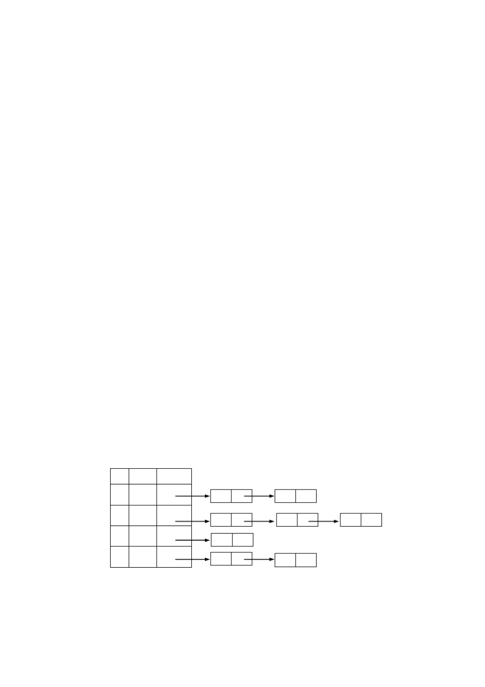

# 《数据结构与算法》课后习题（第 6 至 8 章）

> **说明**：本文档收录《数据结构与算法》课后习题第 19–37 页内容，包含第 5 章树与二叉树算法设计题后半部分（第 6–15 题）、第 6 章图、第 7 章查找以及第 8 章排序的全部选择题、判断题、简答题与算法设计题。

## 5.3.4 树与二叉树算法设计题（续：第6至15题）

### 第6题

6. 一棵具有 $n$ 个结点的完全二叉树采用顺序结构存储，试设计非递归算法对其进行先序遍历。

### 第7题

7. 二叉树中查找值为 $x$ 的结点，试设计打印值为 $x$ 的结点的所有祖先结点算法。

### 第8题

8. 已知一棵二叉树的后序遍历序列和中序遍历序列，写出可以确定这棵二叉树的算法。

### 第9题

9. 编写算法判断一棵二叉链表表示的二叉树是否是完全二叉树。

### 第10题

10. 有 $n$ 个结点的完全二叉树存放在一维数组 `A[1..n]` 中，试据此建立一棵用二叉链表表示的二叉树。

### 第11题

11. 编写算法判定两棵二叉树是否相似。所谓两棵二叉树 $s$ 和 $t$ 相似，即要么它们都为空或都只有一个结点，要么它们的左右子树都相似。

### 第12题

12. 写出用逆转链方法对二叉树进行先序遍历的算法。

### 第13题

13. 对以孩子-兄弟链表表示的树编写计算树的深度的算法。

### 第14题

14. 对以孩子链表表示的树编写计算树的深度的算法。

### 第15题

15. 对以双亲链表表示的树编写计算树的深度的算法。

## 6.3 第6章 图 课后习题

### 6.3.1 选择题

1. $n$ 条边的无向图的邻接表的存储中，边结点的个数有 `[   ]`。
* A. $n$
* B. $2n$
* C. $n/2$
* D. $n \times n$

2. $n$ 条边的无向图的邻接多重表的存储中，边结点的个数有 `[   ]`。
* A. $n$
* B. $2n$
* C. $n/2$
* D. $n \times n$

3. 下列哪一种图的邻接矩阵是对称矩阵？ `[   ]`
* A. 有向图
* B. 无向图
* C. AOV 网
* D. AOE 网

4. 最短路径的生成算法可用 `[   ]`。
* A. 普里姆算法
* B. 克鲁斯卡尔算法
* C. 迪杰斯特拉算法
* D. 哈夫曼算法

5. 一个无向图的邻接表如下图所示（序号 $0, 1, 2, 3$ 分别对应顶点 $v_0, v_1, v_2, v_3$，各链表依次为：$v_0 \to 1 \to 2$；$v_1 \to 0 \to 3 \to 2$；$v_2 \to 0$；$v_3 \to 1 \to 2$）：
- （1）从顶点 $v_0$ 出发进行深度优先搜索，经历的结点顺序为 `[   ]`。
- （2）从顶点 $v_0$ 出发进行广度优先搜索，经历的结点顺序为 `[   ]`。

<div align="center">
  
  <p><em>图1：无向图的邻接表结构</em></p>
</div>

* A. $v_0, v_3, v_2, v_1$
* B. $v_0, v_1, v_2, v_3$
* C. $v_0, v_2, v_1, v_3$
* D. $v_0, v_1, v_3, v_2$

6. 设有向图 $n$ 个顶点和 $e$ 条边，进行拓扑排序时，总的计算时间为 `[   ]`。
* A. $O(n\log_2 e)$
* B. $O(en)$
* C. $O(e\log_2 n)$
* D. $O(n+e)$

7. 含有 $n$ 个顶点 $e$ 条边的无向连通图，利用 Kruskal 算法生成最小生成树，其时间复杂度为 `[   ]`。
* A. $O(e\log_2 e)$
* B. $O(en)$
* C. $O(e\log_2 n)$
* D. $O(n\log_2 n)$

8. 关键路径是事件结点网络中 `[   ]`。
* A. 从源点到汇点的最长路径
* B. 从源点到汇点的最短路径
* C. 最长的回路
* D. 最短的回路

9. 下面关于求关键路径的说法不正确的是 `[   ]`。
* A. 求关键路径是以拓扑排序为基础的
* B. 一个事件的最早开始时间与以该事件为尾的弧的活动最早开始时间相同
* C. 一个事件的最迟开始时间为以该事件为尾的弧的活动最迟开始时间与该活动的持续时间的差
* D. 关键活动一定位于关键路径上

10. 有 $10$ 个结点的无向图至少有 `[   ]` 条边才能确保其是连通图。
* A. $8$
* B. $9$
* C. $10$
* D. $11$

### 6.3.2 判断题

1. 求最小生成树的 Prim 算法在边较少、结点较多时效率较高。 `(   )`
2. 图的最小生成树的形状可能不唯一。 `(   )`
3. 用邻接矩阵法存储一个图时，在不考虑压缩存储的情况下，所占用的存储空间大小只与图中结点个数有关，而与图的边数无关。 `(   )`
4. 邻接表法只用于有向图的存储，邻接矩阵对于有向图和无向图的存储都适用。 `(   )`
5. 任何有向网络（AOV-网络）拓扑排序的结果是唯一的。 `(   )`
6. 有回路的图不能进行拓扑排序。 `(   )`
7. 存储无向图的邻接矩阵是对称的，故只存储邻接矩阵的下（或上）三角部分即可。 `(   )`
8. 十字链表可以存储无向图和有向图。 `(   )`
9. 任何无向图都存在生成树。 `(   )`
10. 若一个有向图的邻接矩阵对角线以下元素均为零，则该图的拓扑有序序列必定存在。 `(   )`
11. 连通分量是无向图中的极小连通子图。 `(   )`
12. 强连通分量是有向图中的极大强连通子图。 `(   )`
13. 用邻接矩阵 $A$ 表示图，判定任意两个结点 $v_i$ 和 $v_j$ 之间是否有长度为 $m$ 的路径相连，则只要检查 $A^m$ 的第 $i$ 行第 $j$ 列的元素是否为 $0$ 即可。 `(   )`
14. 缩短关键路径上活动的工期一定能够缩短整个工程的工期。 `(   )`
15. AOE 网中一定只有一条关键路径。 `(   )`

### 6.3.3 简答题

#### 第1题

1. 对于如图 1 所示的有向图（含顶点 $1, 2, 3, 4, 5, 6$，有向弧为 $\langle 1, 2 \rangle, \langle 2, 4 \rangle, \langle 2, 5 \rangle, \langle 3, 1 \rangle, \langle 3, 4 \rangle, \langle 3, 5 \rangle, \langle 5, 1 \rangle, \langle 5, 4 \rangle, \langle 5, 6 \rangle, \langle 6, 2 \rangle, \langle 6, 3 \rangle$），试给出：
- （1）每个顶点的入度和出度；
- （2）邻接矩阵；
- （3）邻接表；
- （4）逆邻接表；
- （5）强连通分量。

<div align="center">
  
  <p><em>图2：简答题第1题有向图（图1）</em></p>
</div>

#### 第2题

2. 设无向图 $G$ 如图 2 所示（顶点 $V_1 \sim V_7$，边为 $(V_1, V_2), (V_1, V_3), (V_2, V_4), (V_3, V_4), (V_4, V_5), (V_4, V_6), (V_5, V_7), (V_6, V_7)$），试给出：
- （1）该图的邻接矩阵；
- （2）该图的邻接表；
- （3）该图的多重邻接表；
- （4）从 $V_1$ 出发的“深度优先”遍历序列；
- （5）从 $V_1$ 出发的“广度优先”遍历序列。

#### 第3题

3. 用邻接矩阵表示图时，矩阵元素的个数与顶点个数是否相关？与边的条数是否有关？

#### 第4题

4. 设有向图 $G$ 如图 3 所示（顶点 $v_1 \sim v_6$，有向弧为 $\langle v_1, v_2 \rangle, \langle v_1, v_3 \rangle, \langle v_2, v_5 \rangle, \langle v_2, v_6 \rangle, \langle v_3, v_6 \rangle, \langle v_5, v_4 \rangle, \langle v_6, v_4 \rangle, \langle v_6, v_5 \rangle$），试画出图 $G$ 的十字链表结构，并写出图 $G$ 的两个拓扑序列。

#### 第5题

5. 如图 4 所示 AOE 网（事件顶点 $A \sim H$，活动弧：$a_1=\langle A, B \rangle(3)$，$a_2=\langle A, C \rangle(5)$，$a_3=\langle B, D \rangle(6)$，$a_4=\langle C, D \rangle(7)$，$a_5=\langle D, E \rangle(9)$，$a_6=\langle D, F \rangle(10)$，$a_7=\langle D, G \rangle(8)$，$a_8=\langle G, F \rangle(6)$，$a_9=\langle E, H \rangle(5)$，$a_{10}=\langle F, H \rangle(3)$，$a_{11}=\langle G, H \rangle(2)$）：
- （1）列出各事件的最早、最迟发生时间；
- （2）列出各活动的最早、最迟发生时间；
- （3）找出该 AOE 网中的关键路径，并回答完成该工程需要的最短时间。

## 7.3 第7章 查找 课后习题（P152）

### 7.3.1 选择题

1. 静态查找表与动态查找表的根本区别在于 `[   ]`。
* A. 它们的逻辑结构不一样
* B. 施加在其上的操作不一样
* C. 所包含的数据元素类型不一样
* D. 存储实现不一样

2. 在表长为 $n$ 的顺序表上实施顺序查找，在查找不成功时与关键字比较的次数为 `[   ]`。
* A. $n$
* B. $1$
* C. $n+1$
* D. $n-1$

3. 顺序查找适用于存储结构为 `[   ]` 的线性表。
* A. 哈希存储
* B. 压缩存储
* C. 顺序存储或链式存储
* D. 索引存储

4. 用顺序查找法对具有 $n$ 个结点的线性表查找一个结点的时间复杂度为 `[   ]`。
* A. $O(\log_2 n^2)$
* B. $O(n\log_2 n)$
* C. $O(n)$
* D. $O(\log_2 n)$

5. 适用于折半查找的表的存储方式及元素排列要求为 `[   ]`。
* A. 链接方式存储，元素无序
* B. 链接方式存储，元素有序
* C. 顺序方式存储，元素无序
* D. 顺序方式存储，元素有序

6. 有一个长度为 $12$ 的有序表，按折半查找法对该表进行查找，在表内各元素等概率情况下查找成功所需的平均比较次数为 `[   ]`。
* A. $35/12$
* B. $37/12$
* C. $39/12$
* D. $43/12$

7. 在有序表 $\{1, 3, 9, 12, 32, 41, 62, 75, 77, 82, 95, 100\}$ 上进行折半查找关键字为 $82$ 的数据元素需要比较 `[   ]` 次。
* A. $1$
* B. $2$
* C. $4$
* D. $5$

8. 设哈希表长为 $14$，哈希函数为 $H(\text{key}) = \text{key} \bmod 11$。当前表中已有 $4$ 个结点：$\text{addr}(15)=4$，$\text{addr}(38)=5$，$\text{addr}(61)=6$，$\text{addr}(84)=7$。如用二次探测再散列处理冲突，则关键字为 $49$ 的结点的地址是 `[   ]`。
* A. $8$
* B. $3$
* C. $5$
* D. $9$

9. 散列函数有一个共同的性质，即函数值应当以 `[   ]` 取其值域的每个值。
* A. 最大概率
* B. 最小概率
* C. 平均概率
* D. 同等概率

10. 假定有 $k$ 个关键字互为同义词，若用线性探测法把这 $k$ 个关键字存入散列表中，至少要进行多少次探测？ `[   ]`
* A. $k-1$ 次
* B. $k$ 次
* C. $k+1$ 次
* D. $k(k+1)/2$ 次

11. 在哈希函数 $H(k) = k \bmod m$ 中，一般来讲，$m$ 应取 `[   ]`。
* A. 奇数
* B. 偶数
* C. 素数
* D. 充分大的数

12. 在采用线性探测法处理冲突所构成的哈希表上进行查找，可能要探测多个位置，在查找成功的情况下，所探测到的这些位置上的键值 `[   ]`。
* A. 一定是同义词
* B. 一定不是同义词
* C. 都相同
* D. 不一定都是同义词

13. 采用分块查找时，若线性表中共有 $625$ 个元素，查找每个元素的概率相同，假设采用顺序查找来确定结点所在的块，每块应分 `[   ]` 个结点最佳。
* A. $10$
* B. $25$
* C. $6$
* D. $625$

14. 下列关于 $m$ 阶 B 树的说法错误的是 `[   ]`。
* A. 根结点至多有 $m$ 棵子树
* B. 所有叶子都在同一层次上
* C. 非叶结点至少有 $m/2$（$m$ 为偶数）或 $m/2+1$（$m$ 为奇数）棵子树
* D. 根结点中的数据是有序的

15. $m$ 阶 B 树是一棵 `[   ]`。
* A. $m$ 叉排序树
* B. $m$ 叉平衡排序树
* C. $m-1$ 叉平衡排序树
* D. $m+1$ 叉平衡排序树

### 7.3.2 判断题

1. 顺序查找可以在顺序表上进行，不能在单链表上进行。 `(   )`
2. 折半查找只能在有序的顺序表上进行。 `(   )`
3. 对于给定的关键字集合，以不同的次序插入到初始为空的二叉排序树中，得到的二叉排序树是相同的。 `(   )`
4. 若二叉排序树中关键字互不相同，那么，最小值结点必定无左孩子，最大值结点必定无右孩子。 `(   )`
5. 在二叉排序树中，最大值结点和最小值结点一定是叶子结点。 `(   )`
6. 将二叉排序树 $T_1$ 的先序遍历序列依次插入初始为空的树中，所得到的二叉排序树 $T_2$ 和 $T_1$ 的形态完全相同。 `(   )`
7. 对二叉排序树进行中序遍历得到的序列是由小到大有序的。 `(   )`
8. 二叉树为二叉排序树的充分必要条件是任一非终端结点的值大于其左孩子的值、小于右孩子的值。 `(   )`
9. 二叉排序树的查找和折半查找的时间复杂度都是 $O(\log_2 n)$，时间性能相同。 `(   )`
10. 采用折半查找法对有序表进行查找总比采用顺序查找法对其进行查找要快。 `(   )`
11. 采用线性探测法处理冲突时，当从哈希表中删除一个记录时，不应将这个记录的所在位置置为空，因为这将会影响以后的查找。 `(   )`
12. $m$ 阶 B 树每一个结点的子树个数都小于或等于 $m$。 `(   )`
13. 哈希表的查找效率主要取决于构造哈希表时选取的哈希函数和处理冲突的方法。 `(   )`
14. 哈希法存储的基本思想是由关键码的值决定数据的存储地址。 `(   )`
15. 当负载因子 $\alpha$ 小于 $1$ 时，则向哈希表中插入元素时不会引起冲突。 `(   )`
16. 查找表中数据元素的任何数据项都可以作为关键字。 `(   )`
17. $m$ 阶 B 树的任何一个结点的所有子树的高度都相等。 `(   )`
18. 在二叉排序树上删除一个结点时，不必移动其他结点，只要将该结点相应的指针域置空即可。 `(   )`
19. 在哈希存储方式中，负载因子的值越大，存取元素时发生冲突的可能性就越大。 `(   )`
20. 对两棵具有相同关键字集合而形状不同的二叉排序树，按中序遍历它们得到的序列的顺序是一样的。 `(   )`

### 7.3.3 简答题

#### 第1题

1. 画出对长度为 $18$ 的有序的顺序表进行折半查找时的判定树，并指出在等概率时查找成功的平均查找长度，以及查找失败时所需的最多的关键字比较次数。

#### 第2题

2. 已知如下所示长度为 $12$ 的关键字有序的表：`{Jan, Feb, Mar, Apr, May, June, July, Aug, Sep, Oct, Nov, Dec}`。
- （1）试按表中元素的顺序依次插入到一棵初始为空的二叉排序树，画出插入完成后的二叉排序树，并求其在等概率的情况下查找成功的平均查找长度。
- （2）若对表中元素先进行排序构成有序表，求在等概率的情况下查找成功的平均查找长度。
- （3）按表中元素的顺序构造一棵平衡二叉排序树，并求其在等概率的情况下查找成功的平均查找长度。

#### 第3题

3. 试推导含有 $12$ 个结点的平衡二叉树的最大深度，并画出一棵这样的树。

#### 第4题

4. 含有 $9$ 个叶子结点的 $3$ 阶 B 树中至少有多少个非叶子结点？含有 $10$ 个叶子结点的 $3$ 阶 B 树中至少有多少个非叶子结点？

#### 第5题

5. 试从空树开始，画出按以下次序向 $3$ 阶 B 树中插入关键码的建树过程：$20, 30, 50, 52, 60, 68, 70$。如果此后删除 $50$ 和 $68$，画出每一步执行后 $3$ 阶 B 树的状态。

#### 第6题

6. 在地址空间为 $0 \sim 16$ 的散列区中，对以下关键字序列构造两个哈希表：`{Jan, Feb, Mar, Apr, May, June, July, Aug, Sep, Oct, Nov, Dec}`。
- （1）用线性探测开放定址法处理冲突；
- （2）用链地址法处理冲突。
并分别求这两个哈希表在等概率情况下查找成功和不成功的平均查找长度。设哈希函数为 $H(\text{key}) = \lfloor i/2 \rfloor$，其中 $i$ 为关键字中第一个字母在字母表中的序号。

#### 第7题

7. 哈希函数 $H(\text{key}) = (3 \times \text{key}) \bmod 11$。用开放定址法处理冲突。试在 $0 \sim 10$ 的散列地址空间中对关键字序列 $(22, 41, 53, 46, 30, 13, 01, 67)$ 构造哈希表，并求等概率情况下查找成功时的平均查找长度。

#### 第8题

8. 画出依次插入 `z, v, o, q, w, y` 到初始 $5$ 阶 B 树（根为 `(k)`，左孩子 `(c, g)` 的子树依次为 `(a, b)`, `(d, e, f)`, `(h, i, j)`；右孩子 `(p, t, x)` 的子树依次为 `(l, m)`, `(r, s)`, `(u)`）的过程。

## 8.3 第8章 排序 课后习题

### 8.3.1 选择题

1. 在待排序的元素序列基本有序的前提下，效率最高的排序方法是 `[   ]`。
* A. 插入排序
* B. 选择排序
* C. 快速排序
* D. 归并排序

2. 设有 $1000$ 个无序的元素，希望用最快的速度挑选出其中前 $10$ 个最大的元素，最好选用 `[   ]` 排序法。
* A. 冒泡排序
* B. 快速排序
* C. 堆排序
* D. 基数排序

3. 具有 $12$ 个记录的序列，采用冒泡排序最少的比较次数是 `[   ]`。
* A. $1$
* B. $144$
* C. $11$
* D. $66$

4. 下列四种排序方法中，要求内存容量最大的是 `[   ]`。
* A. 插入排序
* B. 选择排序
* C. 快速排序
* D. 归并排序

5. 初始序列已经按键值有序时，用直接插入算法进行排序，需要比较的次数为 `[   ]`。
* A. $n^2$
* B. $n\log_2 n$
* C. $\log_2 n$
* D. $n-1$

6. 下列四种排序方法，在排序过程中，关键码比较的次数与记录的初始排列顺序无关的是 `[   ]`。
* A. 直接插入排序和快速排序
* B. 快速排序和归并排序
* C. 直接选择排序和归并排序
* D. 直接插入排序和归并排序

7. 一组记录的排序码为 $(46, 79, 56, 38, 40, 84)$，则利用堆排序的方法建立的初始堆为 `[   ]`。
* A. $79, 46, 56, 38, 40, 84$
* B. $84, 79, 56, 38, 40, 46$
* C. $84, 79, 56, 46, 40, 38$
* D. $84, 56, 79, 40, 46, 38$

8. 一组记录的排序码为 $(46, 79, 56, 38, 40, 84)$，则利用快速排序的方法，以第一个记录为基准得到的一次划分的结果为 `[   ]`。
* A. $38, 40, 46, 56, 79, 84$
* B. $40, 38, 46, 79, 56, 84$
* C. $40, 38, 46, 56, 79, 84$
* D. $40, 38, 46, 84, 56, 79$

9. 用某种排序方法对线性表 $(25, 84, 21, 47, 15, 27, 68, 35, 20)$ 进行排序时，元素序列的变化情况如下：
- 1) $25, 84, 21, 47, 15, 27, 68, 35, 20$
- 2) $20, 15, 21, 25, 47, 27, 68, 35, 84$
- 3) $15, 20, 21, 25, 35, 27, 47, 68, 84$
- 4) $15, 20, 21, 25, 27, 35, 47, 68, 84$
则采用的排序方法是 `[   ]`。
* A. 选择排序
* B. 希尔排序
* C. 归并排序
* D. 快速排序

10. 快速排序方法在 `[   ]` 情况下最不利于发挥其长处。
* A. 要排序的数据量太大
* B. 要排序的数据中含有多个相同值
* C. 要排序的数据已基本有序
* D. 要排序的数据个数为奇数

### 8.3.2 判断题

1. 插入排序是稳定的，选择排序是不稳定的。 `(   )`
2. 不稳定的排序算法是没有实用价值的。 `(   )`
3. 当待排序的元素很多时，为了交换元素的位置，移动元素要占较多的时间，这是影响时间复杂度的主要原因。 `(   )`
4. 对有 $n$ 个记录的集合进行归并排序，所需要的辅助空间数与初始记录的排列状况有关。 `(   )`
5. 对 $n$ 个记录的集合进行快速排序，所需要的附加空间数是 $O(n)$。 `(   )`
6. 堆排序所需要的附加空间数与待排序的记录个数无关。 `(   )`
7. 对有 $n$ 个记录的集合进行冒泡排序，所需时间决定于初始记录的排列情况，在初始记录无序的情况下最好。 `(   )`
8. 对有 $n$ 个记录的集合进行快速排序，所需时间决定于初始记录的排列情况，在初始记录无序的情况下最好。 `(   )`
9. 对不稳定的排序算法，不论采用何种描述方式，总能举出一个说明它不稳定的实例来。 `(   )`
10. 选择排序的比较次数不会随待排序记录的关键字分布情况而改变。 `(   )`

### 8.3.3 简答题

#### 第1题

1. 以关键字序列 `(tim, kay, eva, roy, dot, jon, kim, ann, tom, jim, guy, amy)` 为例，手工执行以下排序算法（按字典序比较关键字的大小），写出每一趟排序结束时的关键字状态：
- （1）直接插入排序；
- （2）冒泡排序；
- （3）直接选择排序；
- （4）快速排序；
- （5）归并排序；
- （6）基数排序。

#### 第2题

2. 已知序列 `{50, 18, 12, 61, 8, 17, 87, 25}`，请给出采用堆排序对该序列做升序排序时的每一趟结果。

#### 第3题

3. 有 $n$ 个不同的英文单词，它们的长度相等，均为 $m$，若 $n \gg 50$，$m < 5$，试问采用什么排序方法时间复杂度最小？为什么？

#### 第4题

4. 如果只想得到一个含有 $n$ 个元素的序列中第 $k(k \ll n)$ 小元素之前的部分排序序列，最好采用什么排序方法？为什么？如有这样一个序列：`{57, 11, 25, 36, 18, 80, 22}` 得到其第 $3$ 个最小元素之前的部分序列 `{11, 18, 22}`，使用所选择的算法实现时，要执行多少次比较？

#### 第5题

5. 阅读下列排序算法，并与已学的算法比较，讨论算法中基本操作的执行次数。

```c
void sort(SortList r)
{
    i = 1;
    while (i < N - i + 1)
    {
        min = max = i;
        for (j = i + 1; j <= N - i + 1; ++j)
            if (r[j].key < r[min].key) min = j;
            else if (r[j].key > r[max].key) max = j;
        if (min != i) { w = r[min]; r[min] = r[i]; r[i] = w; }
        if (max != N - i + 1)
        {
            if (max == i) { w = r[min]; r[min] = r[N - i + 1]; r[N - i + 1] = w; }
            else { w = r[max]; r[max] = r[N - i + 1]; r[N - i + 1] = w; }
        }
        i++;
    }
}
```

#### 第6题

6. 请回答以下关于堆的问题：
- （1）堆的存储结构是顺序的，还是链式的？
- （2）设有一个大顶堆，即堆中任意结点的关键码均大于它的左孩子和右孩子的关键码。其具有最大值的元素可能在什么地方？
- （3）对 $n$ 个元素进行初始建堆的过程中，最多做多少次数据比较？
